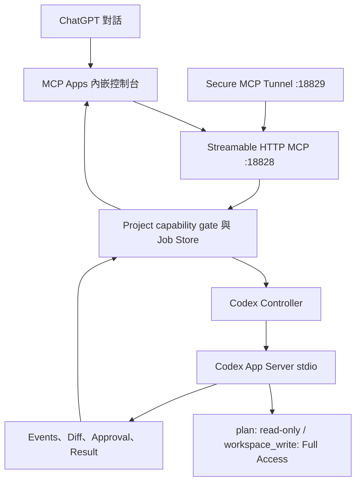

# Codex Handoff Bridge

目前 application release 為 `1.1.0`；MCP Apps、Codex App Server 與 approval contract 仍各自保留相容性邊界。

Codex Handoff Bridge 是私人、allowlist-first 的 MCP Apps 對話工作區。它讓 ChatGPT 將已整理的
工作包交給家中 Windows 主機上的 Codex App Server，並在同一個內嵌介面依專案管理多輪對話、
顯示 Codex 回覆與逐次核准要求。

它不是公司資料政策或封鎖措施的繞過工具。只有個人、公開，或已明確獲准離開公司環境的內容
可以進入這條通道。

2026-10-23 DIRECT NORMAL source：專用 `codex_powershell_normal_execute` 現可在一次經 Bridge
bearer 驗證的 MCP 請求中保存 exact Request，再走原 ApprovalStore／CC Native Host／durable claim。
不需另呼叫 review_get／review_decide 或本機確認；CWD 可在設定專案外，projectId 仍須存在。
這是下述一般 Codex job 路徑限制的專用例外。舊 requestId／digest 與 Receipt 分頁仍相容；
遺失回應可用 idempotencyKey 唯讀找回原單，UNKNOWN 不重送。只有 Tunnel、沒有可驗證 Bridge
bearer 的入口會回 `AUTHENTICATED_MCP_REQUIRED`。本輪未部署、未驗證 live OS 執行；
詳見 [目前實作與交接](docs/RemotePowerShellApprovalPlan.md)。

## 文件導覽

- [Threat Model](docs/ThreatModel.md)：受保護資產、trust zones、資料分類、攻擊面與剩餘風險。
- [Approval Model](docs/ApprovalModel.md)：preview／dispatch、`plan`／`workspace_write`、
  exact approval 與 restart expiry。
- [Job Recovery](docs/JobRecovery.md)：持久化狀態、interrupted job、artifact、重啟與保留原則。
- [Architecture v1](docs/design/architecture-v1.md)：第一版產品決策、state model 與 non-goals。
- [Conversation Model](docs/ConversationModel.md)：App Server history、live item 投影、cursor、reconnect 與 prompt-neutral input 契約。
- [Control Plane Contract](docs/ControlPlaneContract.md)：0.154.0 usage／diagnostics／inventory、通知投影與 compact／review／fork 安全邊界。

## 第一版能力

- 使用者明確要求時，ChatGPT 可用 `codex_direct_job_dispatch`、`codex_direct_conversation_send`、
  `codex_direct_job_steer`、`codex_direct_job_cancel` 直接操作設定 allowlist 內的工作。
  新工作預設 plan、reviewer=auto_review，可明確選 user；資料僅限 personal/public。原有 Widget actions 保留。
- Direct dispatch 必須提供穩定的 `idempotencyKey`；send/steer 必須提供 `clientMessageId`，
  active send/steer 與 cancel 必須指定 `expectedTurnId`，cancel 另帶 `requestId`。
  同 key 不同內容拒絕；不明 delivery 不重送。Receipt 持久保存，每 job 上限 10,000，達限拒絕新 direct 請求。
- `codex_model_list(forceRefresh?)` 回傳模型、efforts、fetchedAt、cacheHit 與 controller identity。
  CLI 精確釘版 `0.154.0`；Astra 可用性與 effort 以實際 App Server 回傳為準。
  模型清單會讀取全部分頁；不完整或失敗不偽裝成空清單。
- Direct content 可操作 user/auto_review job；續接或 steer 省略 reviewer 時沿用既有設定，
  歷史工作缺少 reviewer 時沿用 user。只有使用者明確要求且在 turn 之間才能變更 reviewer。
  含公司資料歷史或分類不可證明的 native import 仍由 Widget 操作。
  Direct cancel 為 stop-only，可停止 allowlist 內的 user/auto_review 工作。
  `user` reviewer 只處理 App Server 實際提出的 approval，不代表每次 workspace 寫入都需要點擊。

- MCP Apps 內嵌對話工作區，使用標準 `ui/initialize`、`tools/call` 與 tool-result bridge。
- Fullscreen 使用 Project Ledger 三區工作區：左側由 server-side unified registry 將 Codex App Server thread、
  Bridge job 與 bounded automation metadata 依 `threadId` 合併為一筆對話，中間保留 user／assistant 與 approval
  敘事，右側集中 plan、command、file change、MCP tool、diff、error 與成品。Codex 已保存且通過路徑安全檢查的實際專案可新增、續接與選擇執行模式；
  磁碟根目錄、使用者家目錄、AppData、`.codex`、Downloads 與系統目錄只提供受保護的唯讀歷史。
- Inline 使用 host 提供的完整對話寬度，只顯示目前對話、最近訊息、待核准與最新工作狀態；專案清單改為
  按需覆蓋層，不會持續擠壓 ChatGPT 畫面。Raw reasoning chain-of-thought 不會投影或保存。
- History reader 先讀 metadata，再依 `historyMode` 選擇 legacy `thread/read(includeTurns=true)` 或 paginated
  `thread/turns/list(itemsView="full")`。Paginated snapshot 讀取前後必須有相同 fingerprint；若中途新增 turn 會完整
  重試一次，仍不一致則保留上一份已驗證 projection。Active job 以 900 ms poll，待補頁以 25 ms catch-up；
  落後超過 200 revisions、超出 hot buffer 或補頁超過 1.5 秒／4 頁時改取完整 Bridge snapshot。Terminal
  thread 每 20 秒、active automation target 每 4 秒只先核對 metadata fingerprint，只有來源變更才抓完整 history。
- Native history 仍會完整讀取並作為權威來源；送往 Widget 的 projection 另有 2,000,000 字元總文字預算，
  每筆 command output 最多 2,000 字元。超限只縮限 UI 技術輸出、保留 item identity／status，並回報
  `native_projection_bounded`；不會修改或截斷 App Server 保存的原始 history。
- App Server user message text 是對話內容權威；Bridge 只以 exact `clientId`／`clientMessageId` 加回 context 與驗證後文字
  文件 metadata，不按訊息位置覆寫文字。Native、Bridge JobStore 與 automation registry 可獨立降級，缺失來源與孤兒排程
  以 bounded diagnostic 顯示，不讓單一 adapter 故障清空整個 Project Ledger。
- Assistant／plan delta 會更新同一個 item；`item/completed` 是 authoritative final state，不會另外產生
  第二個回覆 bubble。中斷或失敗仍保留已收到的 partial output。
- Streaming 通知在每 job 的記憶體 projection 合併，約每 150 ms 提交一次 journal/checkpoint；完成、核准與
  lifecycle 事件立即 flush。對外 cursor 只代表 durable revision。Live polling 使用 count/byte bounded
  recent revision cache，不再每次掃整份 conversation journal。
- Active job 靜默 15 秒後，普通 poll 可嘗試唯讀 native 校正，每 job 至少間隔 30 秒；讀取期間若有新通知、
  revision 或 turn identity 改變，就保留 live projection。恢復不呼叫 `thread/resume` 或 `turn/start`。
- 同一個 job 可透過 `thread/resume` 與 `turn/start` 繼續既有 Codex thread；執行中的補充訊息使用
  `turn/steer`。
- Initial turn、follow-up 與 steer 只由使用者明確輸入和純資料標記區段組成。Bridge 仍產生
  `request.md` 供稽核，但不再把稽核模板或行為提示送進模型輸入。
- 模型與推理強度由 App Server `model/list` 動態提供，並與執行模式一起放在輸入框下方。
- `plan` 唯讀與 `workspace_write` 兩種執行模式。
- 權限 reviewer 可依對話選擇 `auto_review` 或 `user`；預設自動審核。所有 `workspace_write`
  使用內建 `:danger-full-access`，解除 Codex 檔案系統與網路隔離，並保留 `approvalPolicy=on-request`。
  Reviewer 選擇不改變該 execution mode 的 Profile；專案 allowlist 是入口限制，不是檔案系統隔離。
- Widget 可透過 MCP Apps 標準 display-mode request 在 inline 與 fullscreen 間切換；inline 寬度跟隨
  host 對話容器，高度以寬度的 1.12 倍等比例計算並限制在 640 至 960 px，只有 host 確認 fullscreen 後才顯示
  Project Ledger 三區工作區。低於 1080 px 時工作紀錄改為抽屜，低於 760 px 時專案清單也改為覆蓋層。
  `night-shift` 暗色主題以黑藍、石墨與低亮度層級銜接 ChatGPT 暗色畫布；Inline 高度不使用 viewport 高度，
  避免 iframe 自動尺寸回授。
- 輸入框可加入最多 8 份命名純文字文件；Widget 會分段傳送，Bridge 驗證每段與整體 SHA-256、
  UTF-8 大小、MIME、專案及資料分類後，才將內容交給 Codex。
- Bridge 會把驗證後文字複製到 ignored 的 `.tmp/codex-inbox/<job_id>/`，用 server-generated path
  交給 Codex，並在 turn 保留相同內容的 verified inline fallback。
- `plan` 以 Sandbox 保護 staging／job 目錄，並使 `codex-inbox` 唯讀。Full Access 寫入工作
  沒有這些 Sandbox 保證；runtime workspace roots 仍傳入 exact project，但不限制其檔案存取範圍。
- request、final response 與 aggregated diff 會顯示在 fullscreen 工作紀錄區。Widget 按需分段讀取，內容放在
  app-only tool result `_meta`，不會因預覽而自動灌入 ChatGPT transcript。
- 成品可複製；host 支援 MCP Apps `ui/download-file` 時可下載，否則自動改為複製。也可明確送出
  `ui/message`，請 ChatGPT 透過公開讀取工具審核指定成品。
- 公開 MCP caller 只接受 `.local/projects.json` 內的專案 id，不接受任意路徑。Widget 可使用 App Server
  thread metadata 發現的 exact project；client 只持有 opaque project id，不能自行提供或改寫 cwd。
- 每個 job 使用 UUID 目錄，保存 `request.md`、`response.md`、`manifest.json`、`messages.jsonl`、
  `events.jsonl`、`conversation.json`、`conversation-events.jsonl`、`inbox/`、`diff.patch` 與 `result.json`。
- preview digest 與 idempotency key 防止表單變更後誤送或重複建立。
- 人工模式下，Codex App Server 提出的 command 與 file change request 逐次核准；自動模式改由
  Codex 原生 reviewer 處理請求；不提供 session-wide accept 或 blanket allow，亦不保證每項操作都會詢問。
- 重啟後不自動重送未完成 turn，舊核准會標成 expired。
- Windows tray、Startup shortcut 與 Secure MCP Tunnel lifecycle。

第一版不接受 caller 指定任意本機路徑，也不提供二進位附件、專案檔案瀏覽或雙向目錄同步。App Server
發現的 project 必須是存在的實際目錄並通過敏感路徑 deny rules；只有經過
Widget 驗證的純文字文件會取得固定、唯讀的 `codex-inbox` 路徑。Bridge 也沒有 commit、push、發布、
刪除資料、背景網路存取或自動接受核准的工具。

## 架構



Codex App Server 不對外開 listener。只有 Bridge 在本機用 stdio 啟動它；公開入口只能經過既有
Secure MCP Tunnel。每個 Bridge runtime 只有一個 shared App Server child process，所有 thread／turn
共用；停止或 `Stop-Process` 該 PID 是 component-level shutdown／restart，會中斷所有 active turns，不能
拿來取消單一 thread。Per-thread cancellation 必須經 `codex_job_cancel` 走 exact `turn/interrupt`；active job
或 pending approval 期間仍受 approval-sensitive restart guard 保護，也不另建平行 process manager。

## 安裝與設定

```powershell
cd C:\GPT_MCPtool\codex_bridge
npm install
npm run build
```

把範例複製成 ignored 的本機 allowlist，並只加入確實要交給 Codex 操作的專案：

```powershell
New-Item -ItemType Directory -Force .local | Out-Null
Copy-Item config\projects.example.json .local\projects.json
```

格式如下：

```json
{
  "projects": [
    {
      "id": "omi",
      "name": "Open Market Intelligence",
      "path": "C:\\project\\Open Market Intelligence"
    }
  ]
}
```

路徑必須是現存的絕對目錄。filesystem root、相對路徑、未知 id 與重複 id 會被拒絕。

若同一個工作需要跨專案操作，可在這份本機設定加入 `sharedWorkspaceProjectIds`，例如
`"sharedWorkspaceProjectIds": ["projects", "mcp_tools"]`。每個 id 必須已存在於 `projects`，
並各自映射到操作者授權的根目錄。省略時不新增 shared roots；設定後所有 Bridge 工作的
唯讀與保留供回退的 Workspace Profile 都會加入這些 roots。`plan` 仍唯讀；Full Access 不受 roots 限制。

唯讀與回退 Profile 都拒絕讀寫本元件的 `.local`、`.env`／`.env.*`、`.secrets`、`.tunnel-client`、
實際 projects allowlist、`CODEX_BRIDGE_DATA_DIR` 與共用的 `project_reading/.secrets`。
這些規則不適用於 Full Access；`.env`、`.git`、其他專案與使用者檔案不再享有 Codex Sandbox 隔離。
Windows 對 Bridge child process 保留 `windows.sandbox="elevated"`，支援唯讀／回退 Profile；
它不是 Full Access 授權來源，也不改變 Windows 管理員身分或 ACL。
`.env.*` 採原生 glob 規則，匹配於 sandbox 啟動前展開；執行期間新增秘密檔後應重載再啟動工作。

附件鏡像使用 `.tmp/codex-inbox`，避開 Windows 無法在拒絕存取的父目錄中重新開放子目錄的限制。
舊 `.local/codex-inbox` 副本保留；續接附件時 JobStore 由已驗證的 inbox 內容重建新位置。

可選的 `.local/tray-settings.json`：

```json
{
  "projectsFile": "C:\\GPT_MCPtool\\codex_bridge\\.local\\projects.json",
  "dataDir": "C:\\GPT_MCPtool\\codex_bridge\\.local\\runtime",
  "tunnelId": "tunnel_replace_me"
}
```

`npm install` 會安裝固定版本的官方 `@openai/codex` runtime；Bridge 預設以目前 Node 執行其
`codex.js app-server`，避免 Windows Store App executable 無法由背景 controller spawn 的限制。
Codex 必須在同一個 Windows 使用者下已登入。Bridge 使用現有 Codex 登入，不需要 OpenAI
Platform API key。若要改用其他 CLI，可在本機設定 `codexCommand` 與 JSON 字串形式的 `codexArgs`。

既有 installed v5 不會因為此 source 預設或範例改變而自動搬移。若舊 `C:\CodexBridge` 尚在且新預設
目錄不存在，未指定 DataDir 的 source 啟動會拒絕建立第二份資料。正式 v6 必須依
[Runtime 資料遷移](docs/RuntimeStateMigration.md) 經獨立 operator 完成停機備份、binding 與切換。

## 本機啟動與托盤

開發模式：

```powershell
npm start
Invoke-RestMethod http://127.0.0.1:18828/health
```

一般托盤入口：

```powershell
.\scripts\Start-Tray.cmd
```

程式更新後，以 exact-path replacement 重載這一個元件：

```powershell
.\scripts\Restart-Tray.cmd
```

托盤使用 `unified-always-on-v2` 契約。正式啟動會一起準備 MCP server 與 Secure MCP
Tunnel；選單不提供 Start／Stop 或 tunnel restart。Jobs folder 保留在 `Exit` 上方的
元件特有區。MCP 連線能力與 Codex job 的 Profile 分開管理；Full Access job 的網路不受
Codex Sandbox 隔離。安裝目前使用者的 Startup shortcut：

```powershell
npm run startup:install
```

### Control Center v3

正式 registry 使用 `control-center/component.json` 與
`scripts/runtime-control.ps1` 管理 Bridge server／tunnel。舊 tray 與 launcher 保留作 rollback；
`scripts/show-diagnostic-tray.vbs` 只在需要時開啟 component-owned diagnostic UI，關閉 UI
不會停止 runtime。

原托盤的 Copy／Open 操作與 Jobs folder 已透過 `component-menu-v1` 直接接回 Control Center
子選單；中樞只委派固定 action ID，不讀 jobs、allowlist、project path、approval 或 tunnel ID。

Codex Bridge 是 `approval-sensitive` 元件。health 若顯示 active job 或 pending approval，
controller 會拒絕 core restart、full reload 與 shutdown，並保持 PID 不變。controller 不讀 job
payload，也沒有 dispatch、turn、steer、cancel 或 approval decision 能力。完整契約與隔離驗證見
[`docs/ControlCenterIntegration.md`](docs/ControlCenterIntegration.md)。

Controller 與 server 的 Build ID 統一由 `src/config.ts` 的 `computeRuntimeBuildId` 計算；
PowerShell 透過固定路徑 `scripts/runtime-build-id.mjs` 載入編譯後的同一函式，單次 lifecycle
call 只計算一次。正式啟動不需要 `-ExpectedBuildId`；此參數僅保留給隔離測試。
缺少 helper／build 或 helper 輸出不合法時，controller 會在變更 runtime 前回報 `BUILD_ID_*`。
Windows 回歸、cache 邊界與工作結束後的 reload 驗收步驟見
[`docs/RuntimeBuildId.md`](docs/RuntimeBuildId.md)。

## Secure MCP Tunnel

此元件重用 `project_reading` 已安裝的 `vendor\tunnel-client\tunnel-client.exe` 與目前使用者的
DPAPI control-plane key，但使用自己的 `.tunnel-client\codex-bridge.yaml`、tunnel id、health port
`18829` 與 runtime log。`18829` 刻意與 MCP 連續埠及常見桌面程式埠分離，並須在啟用前通過
Windows excluded-range、既有 listener 與 workspace port inventory 檢查。這是 Windows runtime
資源重用，不共享 MCP session 或 job data。

Control Center inventory 只讀取 tunnel executable 的 path／version／SHA-256，不做 automatic
upgrade 或切換。Bridge controller 只在 server／tunnel child spawn 時清除 ambient proxy、bypass
`127.0.0.1`／`localhost`，並立即還原 parent environment；需要企業 outbound proxy 時必須改用
明確、component-owned 設定。

先由 control plane 配發專屬 tunnel id。可將它放入上方 ignored 的
`.local/tray-settings.json`，之後直接執行：

```powershell
npm run tunnel:init
npm run tunnel:doctor
```

也可只在目前 PowerShell session 暫時設定：

```powershell
$env:CODEX_BRIDGE_TUNNEL_ID = "tunnel_replace_me"
npm run tunnel:init
npm run tunnel:doctor
```

不要重用另一個 MCP 元件的 tunnel id。self-test 只回報 ID 是否已設定，不輸出實際值；
profile、DPAPI 密文、log 與 PID 都被 Git 忽略。

Lifecycle controller、`scripts/tunnel.ps1` 與 legacy tray rollback 路徑會收集所有非空的 explicit parameter、
`.local/tray-settings.json`、`CODEX_BRIDGE_TUNNEL_ID` 與 profile `tunnel_id`，並要求它們完全一致。
缺漏、非法格式、重複 profile key 或任一來源不一致都會以固定 errorCode fail closed；
`EnsureRunning`／`RepairConnectivity`／`ReloadRuntime` 會在建立或替換程序前停止。Status 與 SelfTest
只輸出來源名稱、數量與一致性狀態，不輸出 identity value。

本機 profile 檢查與遠端 registration 查驗是兩個不同操作：

```powershell
# 純本機；不查外網
npm run tunnel:doctor
powershell -NoProfile -ExecutionPolicy Bypass `
  -File scripts\remote-connectivity.ps1 -Action SelfTest

# 明確的 read-only 外部 lookup；會使用 component-owned runtime key
powershell -NoProfile -ExecutionPolicy Bypass `
  -File scripts\remote-connectivity.ps1 -Action Lookup
```

`Lookup` 使用 15 秒 timeout、64 KiB output 上限與 5 分鐘 evidence TTL。輸出只含
`status`、`checkedAt`、`validUntil`、安全 `errorCode` 與固定 `source`；remote metadata、
tunnel ID、organization／workspace scope、URL、response body 與 credential 不會被投影。
它不代表 ChatGPT connector 已完成 MCP initialize 或工具呼叫。

成功或已分類的 `Lookup` 會以原子替換寫入 component-owned
`.tmp\remote-registration-evidence.json`。`control-center/component.json` 只宣告這個相對路徑；
Control Center Status 讀取限額 8192 bytes，驗證固定 contract／allowlist／TTL，不會執行外部查詢、
載入 runtime key 或讀取 profile。新鮮 `Ready` 會顯示 `readinessScope=remote_registration`，過期後
如實顯示 `Stale`；ChatGPT connector 仍維持獨立的 `NotChecked` 或 E2E 證據。

## MCP 工具

| 工具 | 權限 | 用途 |
| --- | --- | --- |
| `codex_bridge_status` | read | 主機、allowlist 與最近 job |
| `codex_job_preview` | read | 正規化工作包並產生 digest，不建立 job |
| `render_codex_console` | read/render | 顯示 MCP Apps 對話工作區 |
| `codex_job_get` | read | 讀取 job snapshot 與 bounded events |
| `codex_conversation_list` | read | 分頁列出 allowlisted projects 內的 unified conversations |
| `codex_conversation_get` | read | 先驗證 current thread metadata 仍屬 allowlist，再讀取 unified conversation |
| `codex_unified_conversation_list` | app-only read | 合併 native thread、Bridge job 與安全 automation metadata；回傳來源 diagnostics |
| `codex_unified_conversation_get` | app-only read | 以 native history 為基底讀取對話，並加上 Bridge／automation overlay |
| `codex_local_thread_list` | app-only read | 透過 Codex App Server 分頁列出本機 thread metadata；不掃描 `.codex` 檔案 |
| `codex_local_thread_read` | app-only read | 透過 bounded、redacted projection 讀取一筆本機 thread；讀取本身不採用或修改 thread |
| `codex_artifact_get` | read | 讓 ChatGPT 讀取 bounded request、response、diff 或 result |
| `codex_artifact_list` | read | 列出 request、response 與 diff metadata |
| `codex_text_bundle_begin` | app-only action | 建立 server-owned 文字暫存槽 |
| `codex_text_bundle_append` | app-only action | 寫入並驗證單一文字 chunk |
| `codex_text_bundle_finalize` | app-only action | 驗證整體大小、SHA-256 與 secret policy |
| `codex_artifact_read_chunk` | app-only read | 把 bounded 成品 chunk 只送到 Widget `_meta` |
| `codex_job_dispatch` | app-only action | 送出已預覽的工作包 |
| `codex_conversation_send` | app-only action | 對執行中的 turn 補充方向、續接 Bridge thread，或在明確送出時採用安全的本機 thread 後續作 |
| `codex_job_steer` | app-only action | 對 running turn 補充方向 |
| `codex_job_cancel` | app-only action | 中斷 running turn |
| `codex_approval_decide` | app-only action | 決定單次 command 或 file change 核准 |
| `codex_model_list` | model-visible read | 完整模型分頁、efforts 與 cache metadata |
| `codex_direct_job_dispatch` | model-visible action | 使用者明確指令；固定 user reviewer、設定 allowlist 與防重送 |
| `codex_direct_conversation_send` | model-visible action | 續接符合 direct 資格的 Bridge job；active 時核對 exact turn |
| `codex_direct_job_steer` | model-visible action | 對 exact active turn 補充；共用 send 的資格與防重送檢查 |
| `codex_direct_job_cancel` | model-visible action | 明確停止 exact turn；request receipt 防止重試取消後續回合 |
| `codex_usage_status` | read-only | bounded rate limits、reset credits、account usage；不可用不偽裝成零 |
| `codex_runtime_status` | read-only | 統一 server／permission／sandbox／provider／feature diagnostics；分項降級 |
| `codex_inventory` | read-only | configured project skills／hooks 與 server-wide MCP 狀態；不提供 call／reload |
| `codex_direct_thread_compact` | model-visible action | 明確 compact idle job/thread，exact identity 與持久 receipt |
| `codex_direct_thread_review` | model-visible action | inline uncommitted changes review，plan 權限與既有 history owner |
| `codex_direct_thread_fork` | blocked action | 0.154.0 無可復原的跨 owner fork transaction；不建立 native thread |

`plan` 模式即使收到 file change request 也不能核准。公司資料分類另外要求控制台中的明確授權勾選。
Bridge 對所有 turn 保持 `approvalPolicy=on-request`。`auto_review` 只替換 App Server reviewer，
不是提高權限，也可能拒絕高風險操作；`user` 則把實際提出的 request 送回 Widget 逐次決定。
Bridge App Server 預設為內建 `:danger-full-access`，所有專案的 `workspace_write` 在新建及續接時
明確選用它；不使用自訂 Profile 繼承 Full Access。`plan` 與 Native Review 明確選用
`codex-bridge-read-only`。`codex-bridge-workspace` 定義保留供回退，正常寫入不再選用。
Controller 先用 `permissionProfile/list` 驗證所需 Profile 存在且 allowed，失敗時不降級或繼續執行。
此模式持續生效，直到 PowerShell NORMAL／ADMIN 的正式執行、授權與 Receipt 管線驗收後再恢復。
全域設定、回退方式與驗收狀態見 [遷移紀錄](docs/agent-runs/full-access-20261018/Progress.md)。

## 驗證

MCP Apps Workspace UX v2 使用 `ui://codex-bridge/chat-workspace-v15.html`。歷史 message time 有 native／Bridge／turn／live lineage，
一般訊息只顯示 createdAt；未知時間不顯示。Fullscreen 提供 rail 搜尋、thread controls、turn summary 與按需讀取的 Codex 狀態 drawer；
Review/Compact 沿用既有 exact-identity direct actions，accepted 後仍看 job lifecycle，沒有 fork UI。
資料流與相容性見 [`docs/ConversationModel.md`](docs/ConversationModel.md)。

離線視覺 fixture 可用 `node scripts/preview-workspace-fixture.mjs`，只綁定隨機 loopback port、使用合成 MCP host 回覆，
不連接 live Bridge/App Server。`npm test` 同時執行 projection、journal 與 widget deterministic fixtures。
Source/fixture checks 不代表 live adoption；本輪驗證與 browser 限制記錄於 [`WorkspaceUXv2.md`](docs/WorkspaceUXv2.md)。

```powershell
npm test
npm run widget:check
npm run smoke:http
npm run tray:selftest
npm run tunnel:selftest
```

runtime 啟動後再執行：

```powershell
npm run smoke:mcp
npm run doctor:app-server -- "C:\GPT_MCPtool"
```

明確允許消耗一次真實 Codex turn 的唯讀 smoke：

```powershell
npm run smoke:codex -- --confirm-live-codex
```

`smoke:http` 會驗證 34 個工具、13 個 app-only actions／reads、MCP Apps MIME、resource 內容、HTTP bearer
拒絕、文字 staging 完整週期與 preview 不建立 job。它不會啟動實際 Codex turn。

## Runtime 資料

預設資料根目錄是 `C:\CodexBridge`：

```text
C:\CodexBridge\jobs\<job_id>\
  request.md
  response.md
  manifest.json
  messages.jsonl
  events.jsonl
  conversation.json
  conversation.json.bak
  conversation-events.jsonl
  inbox\
    manifest.json
    <server_generated_artifact_id>.txt
  diff.patch
  result.json

C:\CodexBridge\staging\<bundle_id>\
  manifest.json
  content.txt
  chunks\

C:\GPT_MCPtool\codex_bridge\.tmp\codex-inbox\<job_id>\
  manifest.json
  <server_generated_artifact_id>.<validated_text_extension>
```

這些是本機 runtime state，不屬於 source archive；`.tmp/codex-inbox` 由 Bridge 自動建立，且受 repo
根目錄 `.gitignore` 保護。若 server 在 job 未完成時重啟，該 job 會標為 `interrupted`，不會自動再送
一次可能有 side effect 的 turn。

`conversation.json` 是目前已驗證的 bounded UI checkpoint，`conversation.json.bak` 只保留上一份可驗證
checkpoint；兩者都不是 native transcript source。每次 revision 先以 durable append 寫入
`conversation-events.jsonl`，再以同目錄 temp + rename/swap promotion 更新 checkpoint，不會用 copy 覆寫 active
checkpoint。啟動時若 journal 比 checkpoint 新，Bridge 只依連續 revision 重播缺少的 patch；不完整 final tail
可截回最後完整 boundary，但 middle corruption、conflicting duplicate 或 revision gap 會以 structured error fail closed，
不會建立空 conversation 覆寫既有證據。

## 已知限制

- ChatGPT host 可能快取 tool schema；本機 Restart 後仍可能需要 Refresh Actions 或重新連線。
- Secure MCP Tunnel 必須先有專屬 tunnel id，source code 不會自行建立 control-plane 資源。
- Codex Windows App 套件內的 CLI 若無法由一般終端啟動，需改用同帳號可執行的 Codex CLI，並在
  `.local/tray-settings.json` 設定 `codexCommand`。
- `workspace_write` 中 allowlisted workspace 內的寫入遵循 Codex `:workspace` profile；UI 只會顯示
  App Server 實際提出的核准 request，不保證每個檔案修改前都逐檔停下。需要嚴格 diff-before-apply
  時先用 `plan`，待後續 staged patch workflow 完成後再開放寫入。
- 目前 live transport 是 MCP tool polling 與 revision cursor，不是 SSE／WebSocket；因此是近即時投影，
  不宣稱與 Codex Desktop 的 frame cadence 或所有私有 UI 完全一致。
- Unified inventory 會跟隨 App Server cursor chain，顯式安全上限為 10,000 筆；超過時回傳
  `native_inventory_truncated`，不會把不完整結果宣稱為 complete。
- `conversation-events.jsonl` 仍是 append-only；checkpoint 已是 restart baseline，但 verified-checkpoint-aware
  compaction／rotation 尚未實作。大型 journal 的 polling 與 retention 成本列為獨立 P2 debt，不影響 native
  App Server transcript ownership。
- Raw reasoning chain-of-thought 不會保存或顯示；只投影 App Server 明確提供的 user-visible
  reasoning summary。Command output、diff、error 與其他活動內容仍受 bounded storage、redaction 與 UI preview 上限。
- 文字文件允許副檔名為 `.txt`、`.md`、`.log`、`.json`、`.yaml`、`.yml`、`.diff`、`.patch`；
  單份最多 500,000 字元／2,000,000 UTF-8 bytes，同一次最多 8 份且合計不超過 2,000,000 bytes。
- 目前不提供跨主機檔案同步、二進位附件上傳、任意輸出檔案掃描，亦不會自動清除歷史 staging、
  job inbox 或 `codex-inbox`；清理前必須停止 Bridge 並確認沒有執行中的 job。

## 本機 cooperative shutdown（Source，未部署）

2026-10-15 的 component lifecycle Source 另有固定 `bridge-cooperative-close-v1` 通道：
沿用既有 controller／HTTP／Runtime／ApprovalStore，由 Node 自有 receiver 驗證本機 controller 身分，
只接 probe／shutdown。公開 native dependency 重用相鄰 `mcp_control_center/src/NormalOperator.Native.cs`
與 `RemoteSelfReload.Native.cs`；沒有另建 lifecycle manager 或授權 Journal。
這不是 R1 遠端核准或 PowerShell executor，亦未刷新 live dist／安裝 protected release。
實作與尚未完成的 Windows E2E 見 [LifecycleReadinessCheckpoint.md](docs/LifecycleReadinessCheckpoint.md)。

Control Center 的正式 client 是同一 source／release 內的
`mcp_control_center/scripts/invoke-component-controller.ps1`；它在自身 runspace 執行 Bridge
`runtime-control.ps1`。Host 核對完整 `-File`／`-ControllerPath` 形狀與固定 action 的精確
`ArgumentsBase64`，只接受 `RestartCore`、`ReloadRuntime`、`ShutdownRuntime`，拒絕額外參數及
跨 release 路徑；原直接 controller 入口與 native peer／nonce／ACL 檢查保留。
`powershell -NoProfile -ExecutionPolicy Bypass -File tests/test-cooperative-source.ps1` 會直接測試
manager 組裝、wrapper 解碼與 Host verifier 的 source 契約，不啟動 controller、不代表 Live E2E。
部署須經獨立 review 並沿用既有 Prepare／Install 流程；不能只覆寫現役 Host。

## Remote Self-Reload R1（source / offline）

後續修復仍為 **G0 HOST_NOT_VERIFIED / G1 PARTIAL**；新增 UI source candidate 與 native-handle stop regression，
不覆寫現役 web/dist。驗證請用 `tests/test-r1-isolated.ps1`；[正式安裝阻擋](../mcp_control_center/docs/R1InstalledRelease.md)
尚未解除，不可將 schema v4 視為可部署 release。

Remote Self-Reload R1 是獨立的固定重載流程：新增六個 MCP tools、app-only exact passkey 確認、
Control Center tray-owned durable worker 與跨重啟收據。正式狀態 **NOT_DEPLOYED**；只允許
`codex_bridge / reload_runtime`，需全部 jobs idle 與既有 owner/controller guard。
跨元件只使用固定 authenticated named pipe 和 CC 公開 native IPC verifier，不共享 domain data 或 secret。
詳見 [R1 契約與驗證](docs/RemoteSelfReloadR1.md) 及其連結的 operator bootstrap。

## Remote Privileged Broker V1（source / offline）

獨立 Broker 的 MCP 入口直接提供 `codex_privileged_status` 與 `codex_privileged_preview`，
不經 Codex Controller/App Server。正式 executor **NOT DEPLOYED**；正式模組 ACL 與其他 MCP
防更動 **NOT ENFORCED**。本輪允許修改開發 source，不表示部署後可修改正式 executable/policy。
目前僅開放 status/dry-run preview；request、exact review、receipt/result 僅在獨立 synthetic fixture
驗證。真人 UI／核准 authority 未完成，沒有遠端 request/approval/execute 或管理員服務啟用開關。
詳見 [契約、限制與人工部署前置](docs/RemotePrivilegedBrokerV1.md)。

## InstalledRelease 私有狀態接線（候選）

InstalledRelease v5／binding v3 固定唯一 Control Center owner state 為 `C:\McpControlCenter`，保留 `C:\CodexBridge` 與唯一 ApprovalStore。原 operator 的 `PlanState` 只列出 metadata 計畫；`BindState -StatePlanSha256 <digest>` 核對同一計畫後，將原 `%LOCALAPPDATA%\McpControlCenter` 備份到新私有 runtime，再準備新的 active state。原目錄保留、不再作為 installed owner 的使用中狀態；只有既有 Cutover 會切換 Startup 與單一 Tray。

遷移保留來源與目的全部 Deny，移除新私有範圍的非受信任 Allow，不複製來源 Allow 為新權限。檔案先建立為空並套用 ACL，才寫入已核對 hash 的內容；備份包含舊 PID，但 active root 排除 `tray.pid`。原狀態變動、未知 ACE、reparse、超限或目的已存在均停止；部分複製留下 UNKNOWN，不自動重試。此版本僅處理首次遷移，既有目標必須人工檢視。AppData、workspace、共用 Codex home 與其他元件 ACL 不變；歷史狀態不提供新的 NORMAL Grant。

projects allowlist、tunnel profile 與既有 DPAPI ciphertext 由原登入使用者複製成受 manifest digest 綁定的私有部署快照；不解密、不輸出 credential，不新增 credential 服務。Bridge 在啟動 tunnel 前持有 ciphertext read handle，核對 digest 後才呼叫原 key-store。原設定仍由原元件擁有；設定或 key 更新須重新部署快照，不從 workspace 靜默跟隨。共用 Codex home 保留既有讀取權限，仍檢查 owner、reparse 與不可被外部 principal 寫入／替換；它不提供 NORMAL 授權。

此版本的順序為 Prepare → Install → PlanState → BindState → Preflight → Cutover。r3／r4 已安裝但未啟用；v5 仍為 Source 候選。Preflight／Cutover 再核對原 state 未變；Rollback 沿用原 Startup 備份及原 state，不自動合併切換後的新營運紀錄。Source 測試、安裝、Runtime adoption、Native Host 與 ChatGPT E2E 分別記錄，不互相替代。

2026-10-20：若 r8 已依原 stop／recovery 收據恢復 source，之後 source 又正常運行或重啟，舊 PID／Build 與舊 state snapshot 不能直接沿用。`PlanState`／`BindState` 可明確加上 `-AllowRecoveredSourceAdvance`，但仍必須提供 `-PreviousReleaseRoot`、原 `-StateRecoveryReceipt` 及其 `-StateRecoverySha256`。原 r8 drain／repair／Startup hash 鏈保留，另由當下 canonical controller 核對新的 idle source、PID／start time、Build 與新版 release 的 rollback baseline；Tray 必須先正常退出。預設不加旗標時仍要求原 snapshot 完全一致。

這個承接只允許 CC 狀態快取／日誌變更，以及新增、格式完整的 Workspace Local 去重收據；資料夾型別、舊收據、其他設定的變更或檔案刪除都拒絕。Source ACL 僅接受原值或額外增加 Deny ACE：owner、group、control flags、所有舊 ACE bytes 必須保留，只容許連續 Deny 區段內的排序差異；不接受新增 Allow、移除 Deny，或跨 Allow 移動 Deny。BindState 先保存完整 source owner snapshot，只將新的去重收據寫入同一個 `C:\McpControlCenter`；同 ID 不同內容拒絕覆寫，`UNKNOWN` 原樣保留，舊 installed 營運紀錄不覆寫。完整計畫仍受 `StatePlanSha256`、來源重驗與 partial-failure 不重試規則約束。此路徑不安裝、不切換 Startup、不啟動 Host，也不重播任何操作。

## 逐筆人工核准 NORMAL / ADMIN PowerShell（2026-10-15 現行交付需求）

新需求是可實際執行的 PowerShell 專用管線：`DIRECT` 由使用者直接指定操作，`CODEX_DERIVED` 從真實 Codex Job／Turn 權限故障提案；兩者共用唯一 ApprovalStore、App-only 逐筆檢視與受保護 Windows Host／Control Center Operator，回傳真實 Request Receipt。Source 開發與必要實作已獲授權，不以舊 G0/G1 的固定 Marker、Source-only、不可執行 Review 限制新功能實作。

- 開發／診斷期間若實際呼叫 PowerShell，僅限唯讀查詢；不讀 `.env`／`.env.*`、憑證或其他敏感資料，也不變更正式檔案與 OS 狀態。Source 修改與隔離編譯可繼續。
- 正式可寫／高權限驗收由使用者明確發起，每一筆完整 Script／Args／Mode／影響與 Digest 需另行核准；NORMAL 使用一般權限，ADMIN 另需有效 Windows UAC／OS 授權。歷史平台拒絕不擴大成全 Source 開發禁令，但當下明確拒絕的同一操作不可改用其他工具繞過。
- **本規格不代表正式 Host 已部署。** Source 的 `codex_powershell_status` 分列來源宣告、載入的 installed binding、快取 preflight、未驗證 owner 與既有 Store；NORMAL/ADMIN 仍關閉。`codex_powershell_host_preflight` 只在使用者明確要求時啟動固定 installed helper，不帶 candidate，也不授權。`codex_powershell_receipt` 依原 requestId 讀取同一 Store；審閱意見與保存的 OS receipt 分開，後者仍是 `UNVERIFIED`。本次未部署，刷新與驗證步驟見 [Host 診斷交接](docs/PowerShellHostDiagnostics.md)。

Self-Reload R1 與舊 Remote Privileged Broker 為獨立歷史功能，不能混同 PowerShell 授權 Owner。以 [2026-10-15 現行主計畫](docs/RemotePowerShellApprovalPlan.md) 為權威；[G0/G1 證據](docs/RemotePowerShellApprovalG0G1.md) 僅供驗證繼承，不再限制施工。

2026-10-16 NORMAL 候選已沿用 Runtime 唯一 ApprovalStore、InstalledRelease Host receiver 與既有 NORMAL runner，接通 `codex_powershell_normal_execute`。它只接受已保存的 DIRECT Request ID／Digest；模型宣告不授權，必須由經 native peer 驗證的 Windows Host 顯示完整指令並取得逐筆本機確認。額外平台真人證明不列入本次 MVP；平台已拒絕的工作不得換成 DIRECT 重送。CODEX_DERIVED 與 ADMIN 仍不可由此入口執行。

Grant、Claim、Receipt 維持 durable journal；原 Request ID 可查一次性結果。stdout／stderr 合計最多 16 KiB，經本機確認後在同一 Store 記憶體最多保留 10 分鐘／32 筆，逾期、重啟或容量淘汰後只保留 receipt／output hash。Unknown／Timeout／Lost Response 不得自動重跑。此處描述 Source 能力；InstalledRelease 部署、Runtime adoption 與 ChatGPT 往返仍須分別驗收，見[本次進度](docs/agent-runs/powershell-normal-20261016/Progress.md)。先前 G0/G1 與 Host 文件中的平台阻擋是歷史階段記錄。


## DIRECT NORMAL 遠端執行（2026-10-22 現行需求）

本節取代上述 NORMAL 的逐筆本機確認與手動 arm 流程。經既有 MCP 身分驗證的明確 DIRECT 執行請求，使用原 `review_request` 的 Request ID／Digest，透過 `codex_powershell_normal_execute` 直接交給既有 Windows Host。Host 持續接收新請求，不顯示確認視窗，也不需要每次點 Tray。收據的授權來源如實記為 `REMOTE_MCP_REQUEST / AUTHENTICATED_DIRECT_REQUEST`，不假造本機點選紀錄。

沿用唯一 ApprovalStore、既有一般權限 Runner 與 Request Receipt。相同 Request 只消耗一次；失去回應後讀原收據，不重跑。NORMAL 不會變成 ADMIN，也不替代平台或 workspace 的權限。

stdout／stderr 不再受到 16 KiB 截斷或因此中止程序，完整捕獲後透過同一 Host 通道分段交付。小結果直接回傳；大結果以 `codex_powershell_receipt(requestId, outputOffset=output.nextOffset)` 續讀，直到 `nextOffset=null`，不用重新執行。原有輸出記憶體快取保留 10 分鐘；Journal 仍只保存 hash／計數／Exit Code。原有 30 秒執行期限保留，逾時如實回報 UNKNOWN，不宣稱成功。

修改 source 不會更新受保護的 installed release；需更新 Bridge 與 Host 為同一版本，再重新整理 MCP 工具清單，才能使用此行為。

既有 `installed-release-operator.ps1` 的 `Prepare`、`PlanState`、`BindState` 可使用 `-UpgradeFromReleaseRoot <目前 installed release>` 直接升版。它核對舊 release、Startup 與原 state-binding／cutover 收據，沿用現有私有設定快照；不搬移資料、不回到 source，也不重設現有 ACL。安裝仍由獨立 Windows PowerShell 執行，只有 `Install` 需要系統管理員。

升版期間先保留舊 Tray，讓其原 controller 正常停止 Bridge。第一次 `Cutover` 產生 `UPGRADE_STOPPED` 後，選擇 Tray 的 `Exit control center only`，再執行同一個 `Cutover` 完成版本切換。這是一次性的更新步驟，與執行 PowerShell 請求無關；日常 NORMAL 執行不需要 Tray 點選。只有這個明確的停止階段可續接，UNKNOWN 仍需查明原因，不能重試。
