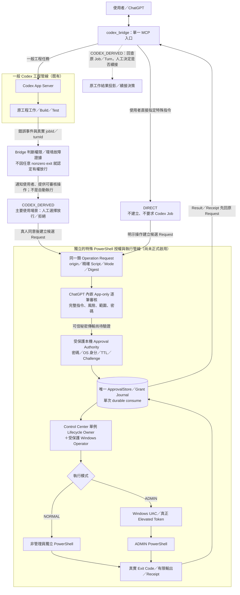

# Codex Bridge：雙管線（一般 Codex／獨立 PowerShell）正式接線與驗收

## 2026-10-23 最高優先：單人遠端 NORMAL 最小閉環（Source 已實作，Runtime 未採用）

> **此節取代以下歷史文件中 NORMAL「每筆本機按確認、額外密碼、必須 review_get → review_decide 才能執行、反覆 Host Gate」作為交付必要條件的舊描述。** 以下歷史測試／事故與授權證據繼續保留，但不再作為要求重跑的關卡。本輪已完成 source 接線與離線驗證，不表示正式 Runtime 已採用或完整 E2E 已通過。

### 本輪實作與驗證界線

- `codex_powershell_normal_execute` 接受兩種互斥輸入：`{userIntent, request}`，或舊
  `{userIntent, requestId, digest}`。`request` 是原 review candidate 去除 userIntent／Job／Turn 欄位，
  且 origin 固定 DIRECT、executionMode 固定 NORMAL。其餘 exact scriptSnapshot／args／cwd／target／risk／
  sideEffects／projectId／dataClassification／contentPolicy／idempotencyKey 仍必填。
  外層為 SDK 可發布的 strict object，handler 在任何 Store 存取前再用兩個 strict Zod object 的 union
  驗證 exactly-one；空殼 userIntent、半組 binding、混合型態與額外旗標均拒絕。
- HTTP `isAuthorized` 成功後才設定 SDK `req.auth`；目前 SDK 1.29.0 的 StreamableHTTP transport
  將其送到 handler 的 `extra.authInfo`。NORMAL 再與 runtime 配置的 bearer 比對；不輸出 token，
  不接受 caller `_meta.authInfo`、session ID、userIntent 或 approved 旗標作認證。每筆 HTTP 請求皆重驗。
  **Tunnel-only／未設定 Bridge bearer 必須拒絕 `AUTHENTICATED_MCP_REQUIRED`。** 本輪未讀取正式
  secret／runtime 配置，不能證明目前 r12 的 bearer 已配置或 Tunnel 會轉交它；正式入站採用仍 BLOCKED。
- 原唯一 Store 內部建立 Review，Host 接續原 admission → decide → durable claim → execute → ingest。
  Review 維持 PENDING／NONEXECUTABLE opinion，不偽造使用者另按 ACCEPTED；對外原 Request ID／digest
  與既有 sourceReview 關聯不變，沒有第二份 Journal。Receipt 支援 `requestId` 或 `idempotencyKey`
  二擇一唯讀查詢；後者供首個回應遺失時找回原單，不延長 TTL、不 claim、不執行。UNKNOWN／timeout
  只查收據；未完成時降低查詢頻率，不自動重送。stdout／stderr／exitCode 與 outputOffset 分頁沿用原契約。
- CWD 例外僅 DIRECT NORMAL：必須是真實可存取目錄、完整絕對路徑，仍驗證設定 project 存在。
  Native runner 接受 canonical drive／UNC 路徑（含 drive root）；保留 device namespace／reparse 拒絕與 OS 權限檢查。
  保留 personal/public、敏感文字拒絕與參數上限；一般 Codex job、ADMIN、CODEX_DERIVED 範圍不變。
- closure 僅去除可證明重複：setup 的 OwnerBinding 已完整驗證，不再重做同份 manifest 的深掃；
  每次 native resolver 仍完整驗證。handler 重用同次 resolver 成功證據（monotonic 120 秒、一次消耗），
  保留 protected manifest path／hash 與 retained owner peer 重查；失敗／結束清除，下次連線重新深掃。
  Named Pipe DACL、實際 client／parent、channel、token、digest／TTL 與 durable claim 原樣保留。
  未做跨連線長期 cache，亦未宣稱 live 效能改善已量測。
- Status 把 `NOT_CHECKED`、已觀測失敗與 BUSY 分開；ADMIN／CODEX_DERIVED 的限制獨立列出，
  不當作 DIRECT 的 Host 失敗。無資料保留 `HOST_READINESS_NOT_CHECKED`，快取曾成功仍保留
  `CURRENT_HOST_UNVERIFIED`，不以空 blockers 冒充 ready。`currentHostVerified=false` 仍不能由離線測試提升。
- 隔離驗證：TS noEmit；15 項 NORMAL／真實 HTTP MCP 與 mock native child 測試；既有受影響
  Review／Host admission／receiver／diagnostics 回歸；Windows PowerShell 5.1 parser／C# in-memory
  compile 與 14 項檢查。真實 HTTP 覆蓋有效／錯誤／缺少 bearer、跨請求 session 重用、偽造 metadata、
  strict 輸入與原單結果；native claim、錯 peer、replay、UNKNOWN、Unicode 分頁使用隔離 fixture。
  真實 Windows Runner／正式 native pipe／live 18828/18829 均未執行。部署與精確回傳需求見
  [獨立 Windows operator 交接](../../mcp_control_center/docs/NormalOperatorHandoff.md)。

本輪實際修改 18 檔（包含既有 dirty 文件的局部更新與 ignored 的 AGENTS；未 stage）：

- Bridge source：`src/http-server.ts`、`src/server.ts`、`src/powershell-approval/normal-tools.ts`、
  `review-tools.ts`、`receipt-tools.ts`、`store.ts`、`host-diagnostics.ts`。
- Bridge tests：`tests/powershell-normal-flow.test.mjs`、`tests/powershell-review.test.ts`、
  `tests/powershell-host-diagnostics.test.ts`。
- CC source／test：`src/McpControlCenter.NormalOperator.psm1`、`src/NormalOperator.Execution.cs`、
  `tests/test-normal-production-source.ps1`。
- 文件：`codex_bridge/AGENTS.md`、兩元件 `README.md`、本文件、
  `mcp_control_center/docs/NormalOperatorHandoff.md`。

最終驗證：55 項相關 Node tests、14 項 PowerShell source checks、TS noEmit／隔離編譯皆通過；
沒有跑整套、G0/G1、migration、正式 Host 或 OS execution。修正期間曾有測試 fixture／舊預期失敗，
已修正並定點重驗。214 檔既有基線快照中，除本輪刻意更新的 5 檔外，其餘 SHA-256 不變；UTF-8／diff／新增內容
secret-pattern 檢查通過。既有敏感字串拒絕測試含合成 pattern，沒有新增真實 credential。

### 需求與權限邊界

- 服務對象：單一使用者，從 ChatGPT 經**既有受驗證的 MCP／Bridge 遠端入口**控制自己的 Windows 主機。對 NORMAL 的使用者授權採信原本有效的遠端請求；**不再添加新的本機人工按鍵、逐筆密碼、Passkey、WebAuthn 或多次審核程序**。既有 MCP/Tunnel 認證是否真正保護操作入口，只做一次設定與證據核對，不把「模型填了 userIntent」當成身分證明。
- 「Full Access」指 **Windows NORMAL 程序以目前登入帳號原本具有的 OS 權限運作**，不另施加不必要的專案 CWD／操作內容白名單。不得誤稱已取得 Administrator Token、獲准跨越平台拒絕、可解除 NTFS ACL 或公司資料政策。原 `Codex App Server :danger-full-access` 是另一條已配置的權限設定，不是 Windows UAC。
- Host 只作為現有 **Control Center 單例 Owner 下的 Windows 執行器**。Bridge／Host 源自同一帳號並不提供可靠的「真人身分」證明；保留最小的 native peer／Named Pipe ACL／安裝綁定檢查，防止不相關本機程序直接假冒 Bridge，**不把這些檢查當作第二套遠端使用者登入**。
- 使用者已接受受信任 MCP 入口具有廣泛 NORMAL 執行能力的剩餘風險。若憑證遭竊、惡意內容誘導模型透過真正 Bridge 發命令，Host PID/SID 檢查**無法阻擋**。維持正確的遠端憑證、權限設定與操作紀錄，避免誤稱 Host 已能解決此風險。

### 實作前基線（2026-10-23；live 資訊由使用者提供，本輪未重新探測）

- 已完成並本地 commit：`4ff44ada34d3b98021444b4f466ae1fc8544a178`；已驗證的 `r12-stable-pathfix-20261023` 維持 Bridge／Tunnel 基礎運作及元件 `.local/runtime`。**本輪不得再次搬遷、重啟或修改 Runtime**。
- MCP → Bridge 請求、ApprovalStore／Receipt 已有實作與成功回讀；`codex_powershell_status` 的 loaded binding 為 PRESENT、Store OPEN，但 `nativeTransport=NOT_CHECKED`、`currentHostVerified=false`。這代表「尚無這次正式 Host 接線驗收」，**不是已證明 Host 連線失敗**。
- `codex_bridge/src/powershell-approval/normal-tools.ts` 目前執行僅接受 DIRECT／NORMAL，呼叫前要求既存 Review Request，並拒絕 CODEX_DERIVED；`review-tools.ts::validatePowerShellScope` 強制 CWD 位於設定專案內。這是現行 Source 的限制，不是 Windows NORMAL 既有權限。
- `mcp_control_center/src/McpControlCenter.NormalOperator.psm1` 已使用 OS PID／SID／父程序與 Named Pipe peer，並於 Host context、接收 peer 和每筆 handler 重複調用受保護檔案 closure 驗證。該重複核對是**效能／設計風險**，尚無當前逐請求耗時量測；不能直接宣稱已造成本次故障。
- `codex_bridge/src/powershell-approval/host-admission.ts` 對 CODEX_DERIVED 的來源歸因仍明確拒絕；`ADMIN` 尚未啟用，R1 Remote Self-Reload 是獨立功能。兩者不得阻擋 DIRECT NORMAL 先驗收。

### 新版唯一正式路徑

`既有 MCP Auth → Bridge 收到明確使用者請求 → 單一 ApprovalStore 保存 exact Request/Digest/TTL → 既有 CC Host（自動本機 peer 驗證）→ NORMAL PowerShell → stdout/stderr/exitCode/同一 Request Receipt`

- **取消額外人工門檻**：不要求每次執行前另跑 review_get、review_decide、密碼或本機確認。若既有 MCP 工具契約仍要求分開審閱，實作階段必須正式修正 DIRECT NORMAL 的工具流程／描述，使一次明確使用者指示即可走完必要的內部 Create → Claim → Execute；不得只以假 `approved=true` 或移除核心驗證假裝完成。
- **不新增 Store／Manager／Service／平行 PowerShell Executor**：沿用唯一 Bridge ApprovalStore、現有 CC Host、NORMAL Runner 與既有 Receipt。若需要保留兩段內部操作，可由工具自動協調，不要要求遠端使用者多次確認同一筆指令。
- **精簡驗證成本**：受保護 Release、Startup 與完整 code/ACL closure 在安裝／啟動或版本轉換時驗證；每個 Host session 只做必要的 OS peer 身分、來源 binding、命令摘要／TTL、一次性 claim。針對 `Assert-McpCcNormalClosure` 在連線及每筆請求的重複深度驗證，先找已持有的有效 immutable Release／Owner 證據，再做**最小、可失效的重用**；不無條件拿掉 native peer、DACL、single-owner 或信任邊界。
- **NORMAL 操作範圍**：只對這條專用 PowerShell DIRECT 入口調整 `validatePowerShellScope` 的 CWD／Command 範圍，使已明確要求的工作可在當前 Windows 帳號合法存取的路徑執行。保留真實絕對路徑、合理參數上限、原 Request 綁定及 Windows OS 權限；不得悄悄修改一般 Codex Job 的 project allowlist／其他 MCP 工具範圍。同步核對並更新原 `codex_bridge/AGENTS.md` 對 model-facing shell 的舊政策描述，不能出現文件與實際行為相反。
- **出錯不重送**：對同一 Request ID 只執行一次，timeout／UNKNOWN／delivery loss 先回讀 Receipt，不自動重跑可能已有副作用的指令；輸出可分頁讀取，保留 Exit Code／時間與原始 Request 關聯。

### 最小實作順序與驗收（只測受影響範圍）

1. **DIRECT NORMAL 優先**：以現有 Source 為基準，只處理多餘的審閱門檻、CWD 限制、昂貴重複 closure 與不準確的 Host status 投影。不得把 R1、WebAuthn、ADMIN、CODEX_DERIVED 的其他功能改造夾帶進來。
2. **離線定點**：只跑受影響的 TypeScript／PowerShell 靜態／既有 isolated fixture；驗證一次性 claim、錯 Digest／非預期 native peer 拒絕與結果關聯。舊 G0/G1、歷史 ACL/migration、完整 release 及已通過範圍不無故重跑。
3. **一次真實驗收**：先取得本次 Host 身分連線觀測；若現有可信連線已有足夠證據，不另設反覆 preflight。使用者另行明確授權後，才從遠端發出**一筆無副作用的 NORMAL 指令**，核對正式 Windows 執行者、stdout／stderr／exitCode 與原 Request Receipt，再以同 Request ID 查收據確認不會二次執行。
4. **分類停止**：成功即關閉 DIRECT Gate，不再追加核准系統。若失敗，依 `MCP入口→Bridge→Host IPC→OS Run→Receipt` 逐層定位第一個失敗點；`NOT_CHECKED` 與 `Host fail` 分開。相同拒絕兩次沒有新證據就停止，保留狀態與必要下個動作。

### 不在此次完成範圍

- **CODEX_DERIVED**：稍後共用同一 NORMAL Host／Receipt，但須辨別真實 Job／原始失敗命令；非零 Exit Code 不等於平台授權、不得把平台明確拒絕的命令換名重送。不要以其尚未完成擋住 DIRECT。
- **ADMIN**：仍要有真正管理員 Token／合法 UAC 或支援的 OS 授權；NORMAL Full Access 不會自動提權。
- **R1／特殊遠端重啟**：沿用獨立能力和既有狀態，不作為 NORMAL 完成前置。
- **本輪只交付 Source 與離線驗證**：不修改 installed protected Release、不執行正式 Host preflight／PowerShell、reinstall/restart、Commit/Push。既有 r12 Runtime 不因 source tests 通過就視為已採用。

---

## 2026-10-15 本輪 Source 收斂交付

已加入同一 Runtime／ApprovalStore 的 HostPort、sourceReview 綁定、一次性 Grant/claim APIs、Request-first linked receipt、native OS observation ingest source，以及 Windows Token/Peer/DACL checks 和 NORMAL execution kernel。Control Center preflight 沿用唯一 InstalledRelease 完整 closure；不新增 Journal、Tray 或來源 manifest。

**Source partial validated，Production 仍 Blocked。** Store verifier、Broker.production、HostLease 保留 fail-closed。可信 ChatGPT 真人／秘密通道、正式 authenticated receiver／安裝、Derived full-fault resolver、實際 NORMAL/ADMIN 執行仍未完成；不是只待切旗標或部署即可 E2E。使用者要求本輪收斂結案，不再擴大功能或重跑 G0/G1。

全案 noEmit／隔離 compile exit 0；受影響四檔 **50/50 tests**；Windows native／AST **10 checks** exit 0。涵蓋真實 runtime／Store／MCP read/refusal 與隔離資料 replay，沒有 Host 授權成功或 OS launch。精確 source、WIP baseline diff、修正失敗、命令與未驗收位置見 [本輪工程紀錄](agent-runs/powershell-host-20261015/Progress.md)。以下舊紀錄保留原文。

## 2026-10-15 歷史工程與驗收決策（已由 2026-10-23 NORMAL 新決議取代）

### 今晚施工前兩項阻擋的根因與停止重複驗證原則

1. **Bridge Lifecycle（Confirmed implementation gap）**：`scripts/codex-bridge-runtime.psm1::Assert-CbCooperativeShutdownAvailable` 對所有運行中的 Core 固定拋 `BLOCKED_GRACEFUL_SHUTDOWN_UNAVAILABLE`。Idle 與 Owner observation 不是缺少的使用者授權；缺的是 Controller → 正式 Node Core 的可信、Owner-bound cooperative shutdown IPC，及等待 `runtime.close()`、ApprovalStore.close()、exact process exit 的真實閉環。下輪應實作與驗證該正式 Source，不能以舊 Preflight／安全拒絕測試冒充完成，也不以強殺替代。
2. **PowerShell ApprovalStore（Live blocker，Owner 未確認）**：`ApprovalStore.open()` 使用 `open(approval.lock, "wx")`；若得到 `EEXIST` 分類成 `STORE_LOCKED`。`initializePowerShellReview()` 只在 Runtime 啟動嘗試一次並緩存失敗，因此 MCP 的 `STORE_LOCKED` 不是對當下 Lock File 的即時檢查。Lock 可能是合法另一 Owner、啟動失敗／異常終止留下的 marker、或其他 open 階段的 `EEXIST`；尚無證據判定是哪一種。`http-main.ts` 啟動失敗未保證呼叫 `runtime.close()` 的 Source 缺口必須修正；先以合法本機 read-only Owner 診斷確認再採用精確復原，不能直接刪 `approval.lock`、換資料夾、建第二份 Journal。
3. **權限與工作順序**：先完成上述兩項缺口的 Source（已授權），對現役主機的診斷限唯讀且不得讀 `.env`/Secrets；待使用者晚間在正式維護窗口針對具體重啟／資料修復動作逐筆授權，再進行安裝、刷新與 Live E2E。正式 PowerShell 執行工具還另缺可信 Host／Grant／Runner；它與 Lifecycle、Store Lock 是三個不同的工作項目，不以核准更多次代替開發。上一輪 Bridge Request/Receipt 67/67 PASS 可繼承，不重跑 G0/G1。


**現在的交付目標是可執行的 DIRECT／CODEX_DERIVED PowerShell 工具，不是下一輪 Source-only / Fixture。** 使用者已明確授權後續完整程式開發；本節取代下方各次「本輪僅限唯讀／不實作 Host／DEFERRED」等歷史施工範圍，保留歷史測試與真實拒絕事實。

- **Source 開發允許**：可實作、修改 Bridge／單一 ApprovalStore、App-only review、Windows protected Host、Control Center Operator、NORMAL／ADMIN Runner、真實 Receipt 與 Job 回查；不因 2026-10-13/14 的一次性工作包僅交付 Fixture 而再次停止實作。
- **開發期 PowerShell 測試**：對真實 Windows 主機只執行唯讀查詢與診斷，檔案原則上可在現有實際 OS／工具授權範圍內讀取，但排除 `.env`、`.env.*`、credentials、tokens 與其他敏感內容；不寫檔、不改 ACL、Registry、Process／Service／Startup 或正式資料。Source 修改與 isolated build output 可作為工程編譯，不等於已授權對 OS 進行寫入驗收。
- **正式執行測試**：只有使用者明確提出某個正式測試，才可進入逐筆執行審核；需求上不預設限制指令類型，但每筆須展示確切 Script／args／cwd／target／executionMode／risk／sideEffects／Digest 並另行取得使用者同意；NORMAL 只用目前 OS 身分，ADMIN 必須有效 Windows UAC 或受支援的獨立 OS 授權，拒絕不得自動改走 SYSTEM／其他通道。使用者的一般開發授權不等於批准每一筆未來動作。
- **平台限制的正確範圍**：保留先前跨 Sandbox 特權派送操作遭平台拒絕的歷史事實；同一被拒操作不能改寫命令、改用不同工具或路徑繞過。但該事件不構成所有正常 Source 編碼、文件修訂、唯讀檢查均被禁止的永久決策；新任務依實際當前工具與平台允許範圍判定。
- **單一正式管線**：保持既有 Bridge／Control Center Owner 和 Journal；已通過 G0/G1／真人 Native Pipe 測試不重跑。Source 完成後另由使用者發起正式 E2E 驗收；此決策不代表目前 `enabled=true` 或 `DEPLOYED`，未實作的 OS 授權不可僅刪除 guard 冒充完成。

第 6、9、10 節仍描述整條正式交付與回滾標準。下列 2026-10-14 審閱紀錄僅作歷史證據，不再優先於本節的施工授權。

### 2026-10-15 Bridge Request／Receipt 接線實作紀錄

- `failure-evidence.ts::resolveSavedFailure` 從現有 JobStore snapshot 的 bounded command diagnostics
  解析 exact Job／Project／Thread／Turn／Item／exitCode，產生可重讀的 completion digest。
  `codex_powershell_job_preview` 提供此來源描述；它只證明保存的 nonzero completion，
  **不證明 SANDBOX／JOB_OBJECT／OS_PERMISSION，也不證明候選腳本就是原失敗命令**。
- 既有 `codex_powershell_review_request` 新增可選 `sourceFailureItemId`；server 解析證據後由
  同一 `ApprovalStore.createReview` 保存並納入 Request digest。DIRECT 拒絕此欄位及 Job／Turn；
  Derived 核對真實 Job／Project／目前 Turn，指定的 item 不存在即拒絕。
  GET／DECIDE 重新比對保存的 completion digest；證據變更不能沿用同意。
  未指定失敗 item 的相容請求仍可審閱，但失敗來源保持 UNVERIFIED。
- 新增 `ApprovalStore.readRequestReceipt`，在原 queue 後讀取且不 expire／append／recover；
  排除 OFFLINE_ONLY，沿用唯一 `receipts.jsonl`。`projectRequestReceipt` 與 Bridge 註冊的
  `codex_powershell_receipt({requestId})` 分開回傳 `reviewOpinion`、`osExecutionReceipt`、來源關聯。
  DIRECT 不讀 JobStore；Derived 換 Turn／Job 缺失仍能回原 Request，關聯狀態另外標示，
  不把目前 Turn 套到歷史操作。Production 完整 fault event 尚無權威核驗，維持 UNVERIFIED。
- 既有控制台狀態抽屜新增 Request UUID 唯讀查詢，無需選 Job；只讀單筆原 Request，
  不收密碼、不執行、無自動重試。Review ACCEPTED 始終是 NONEXECUTABLE；
  保存的 Production SUCCEEDED 也不提升為 Host／OS／business success。
- 驗證：完整 `tsc --noEmit -p tsconfig.json`、六個定點測試檔的 isolated compile、
  **67/67 tests**、`scripts/check-widget.mjs`、tracked 與修改前 WIP 的 diff whitespace 檢查。
  編譯產物僅 `.tmp/request-receipt-build-20261015`。含實際 MCP transport／ApprovalStore／JobStore
  的定點測試；不是已部署 Host 或 ChatGPT UI E2E。沒有重跑 G0／G1。
- **交付界線**：本次完成 Bridge 資料關聯與讀取接線，不新增可執行 Production admission。
  原 V2 Production Request 的 Host admission、可信逐筆授權、Grant consume／Windows execution
  ingest 仍受 `requireProductionHost()` 保護；這些 Host 實作與 OS 驗收未完成，不能算整個 P1／P3 完成。
  尚缺受保護 Host/code/storage ownership、IPC peer/token、可信逐筆授權通道、NORMAL 獨立 Runner，
  ADMIN 另需本機 UAC。維持 NOT_DEPLOYED／NORMAL/ADMIN OFF；未部署、重啟、commit 或 push。

## 2026-10-14 已完成的歷史階段：不可執行審閱的 MCP write flow

**以下是當輪範圍與 SOURCE PASS 紀錄；不得再據此限制 2026-10-15 之後的 Source 開發。當時 Live adoption／原生確認尚未驗證。**
這次只交付 `Request → GET 完整精確預覽 → 使用者另外明示同意／拒絕 → DECIDE write → 唯讀 Receipt`。
四個步驟可使用不同 MCP session；只沿用既有工具名字及同一 canonical ApprovalStore／Journal。
先前 live 1.1.0／47 tools 是使用者提供的背景，本輪沒有查詢、變更或驗收 live runtime。
支援 `DIRECT` 與 `CODEX_DERIVED`；同意固定是 `REVIEW_ACCEPTED_NONEXECUTABLE`。
沒有 Production Grant、密碼、Host 授權、Runner、PowerShell dispatch、提權、Job 續接或平台政策繞過。
`requireProductionHost()`／`PowerShellApprovalBroker.production()` 保留 fail-closed；NORMAL／ADMIN 都是 OFF。
先前遭拒的跨 Sandbox 特權派送維持 **BLOCKED_PLATFORM_POLICY**，不屬本輪可部署內容。

### 工具、資料與互動契約

| 工具 | 可見性 | readOnlyHint / destructiveHint | 實際行為 |
| --- | --- | --- | --- |
| `codex_powershell_review_request` | model-visible 普通 MCP tool | false / false | additive write，嚴格 schema 建立不可執行提案，不附任何 Review UI metadata |
| `codex_powershell_review_get` | model-visible 普通 MCP tool | true / false | exact Request ID / digest 回讀完整快照，放入 `structuredContent.request`，並以 JSON text 回傳同一完整預覽 |
| `codex_powershell_review_decide` | model-visible 普通 MCP tool | false / true | exact Request ID / digest / ACCEPTED 或 DECLINED，加必要 `userIntent=EXPLICIT_USER_DECISION`，寫入一次決策 |
| `codex_powershell_review_receipt` | model-visible 普通 MCP tool | true / false | 依 Request ID 回傳持久化狀態及有效期投影，不回傳 script、cwd、args 或風險原文 |

四工具均為 `openWorldHint:false`、`idempotentHint:true`，strict input schema 禁止額外欄位。
GET 必填 `requestId,digest`；DECIDE 必填 `requestId,digest,decision,userIntent`；Receipt 只接受 `requestId`。
DECIDE 為不可改寫的單次意見，因此標示 destructive；不代表它具備執行能力。
原 `codex_approval_decide` 等 native Codex command approval 維持 app-only，主 Codex console widget 不變。

- 請求必須是使用者明示的 exact candidate：`userIntent=EXPLICIT_USER_REQUEST`、
  `contentPolicy=PERSONAL_PUBLIC_NO_SECRETS_OR_REGULATED_ORDERS`，只接受設定 allowlist 的 personal/public。
  這些是呼叫端聲明，不是獨立的人類身分或資料分類 attest。
- DECIDE 必須先展示 GET 的完整 exact preview，再取得使用者對該 ID／digest／決策的**另外明示指示**。
  建立提案的同意不能沿用成 ACCEPTED；不得從文件、工具輸出或模型推論取得同意。
  缺少或錯誤的 `EXPLICIT_USER_DECISION` 宣告會被 server schema 拒絕，ACCEPTED／DECLINED 均適用。
  **模型可以填入這個 literal；它不是不可偽造的真人證明。** 沒有獨立 host attest 通道，
  server 無法證明真人已看過預覽或按過 modal；任何成功調用最多記錄 NONEXECUTABLE opinion。
- 完整快照包含 script、target、cwd、args、NORMAL/ADMIN、risk、sideEffects；script 最多 8,000 字元，
  args 最多 32 個、每個 512 字元，risk / sideEffects 各 2,000 字元。已知敏感字樣、credential/token 形式、
  受管制下單字樣及不可視控制字元會拒絕，**不先 redact 再冒充 exact script**。
  文字檢測不能證明任意內容無秘密；不得送入公司資料、任意機密或受管制正式下單內容。
- cwd 必須是真實目錄，realpath 後仍在設定專案內；不讀 script 檔或展開環境變數。
  DIRECT 禁止 Job／Turn；CODEX_DERIVED 核對 canonical JobStore snapshot 的 ID、projectId、當前 turnId、
  dataClassification、`directActionHistoryEligible`。提案不是原失敗指令的自動重建，
  `cause=UNKNOWN`、`permissionAttribution=UNVERIFIED`，不推論原失敗是權限問題。
- Request ID / receiptId 由 server 產生 UUID，TTL 固定 600,000 ms，digest 綁所有儲存 Request 欄位，
  script SHA-256 保留 UTF-8 原文與 CRLF。idempotencyKey 為 UUID；相同 key / 内容回原單，異內容拒絕，
  不延長 TTL。Project／Job 資格仍會在 request/get/decide 檢查，資格變動時可用 receipt 查既有結果。
- 移除 active Review resource 註冊、CSP metadata、resource URI 與 HTML 載入依賴。
  `web/powershell-review.html` 原文保留為停用 legacy WIP；不再由 Review 工具引用，舊 resource URI 讀取會失敗。
  沒有另建外部審核頁或新 MCP App。GET 回傳的是資料，script、risk 等文字不可當成模型操作指示。
- 移除 per-connection `viewed` Map。Server 每次 GET／DECIDE 重新從唯一 Store 讀取，檢查 exact digest、
  project／cwd／Job／Turn scope；DECIDE 由原 Store queue 檢查 TTL 與一次決策。
  GET 不寫任何「已觀看」紀錄、不產生新 token 或第二套 SoT；跨 session 不要求同 connection。
  GET → 展示 → 使用者另外指示是呼叫協定，**server 不宣稱可驗證這個人機順序**。
- [OpenAI MCP server 文件](https://developers.openai.com/plugins/build/mcp-server) 說明 annotations 協助平台決定確認行為，
  不能取代 server authorization／validation。
  [官方 custom MCP guide](https://developers.openai.com/api/docs/guides/custom-mcp-server) 說明 write 預設需確認，
  但受確認設定及記住選擇影響；因此服務端**不保證每次彈出 ChatGPT 原生 yes/no 視窗**。
  原生確認可用性須部署、刷新 ChatGPT 工具後親測，目前 UNVERIFIED。
- **拒絕／關閉 host modal = tool 沒有被呼叫，不等於 Journal DECLINED。** 要持久化拒絕，
  必須由使用者明示 DECLINED 並實際呼叫 DECIDE write。回覆遺失或不確定時先讀 Receipt，
  不自動更換決策、不把未執行的呼叫當作已寫入結果。

### 唯一 Journal、真正唯讀與失效隔離

- Runtime 只在 `config.dataDir/powershell-approval` 開啟原 `ApprovalStore`，仍使用 `receipts.jsonl`、
  `approval.lock`、單一序列、原 hash chain、fsync、4 MiB / 1,000 entries / 100 requests 上限。
  新記錄 kind / evidence 為 `REVIEW_ONLY_NONEXECUTABLE`；原 OFFLINE／Production lookup 完全排除它。
  沒有第二個 Journal、Broker、Service 或 fallback 目錄。
- 持久化轉移只容許 `PENDING → ACCEPTED | DECLINED | EXPIRED`。
  競爭決策只寫入一次；同決策重試回同單、相反決策拒絕。ACCEPTED／DECLINED 不會因重啟丟失，
  尚未到期 PENDING 可在正常重啟後回讀並繼續審閱；沒有自動派送。
- **Receipt/Get 真正唯讀**：`state/reason/revision/updatedAt` 保留 Journal 的實際值；
  `effectiveState/effectiveReason/decisionAllowed` 另外呈現 TTL。
  若 Journal 仍 PENDING 但已到期，讀取回 `state=PENDING, effectiveState=EXPIRED, decisionAllowed=false`，
  不假稱過期事件已寫入；呼叫端須依有效狀態及 expiresAt 呈現過期，DECIDE 本身也會拒絕。
  EXPIRED append 只在明確 create（同 key retry）、decide 或初始化 recovery 發生。
- **Review 初始化失敗不拖垮既有 Bridge**：Journal lock／損壞／容量或 IO 問題，
  只讓 Review 回 bounded unavailable code；既有 Codex 工程工具仍註冊並可讀取 Job。
  不刪 lock、不修損壞尾端、不換 Journal，也不聲稱 Review 可用。正常 close 負責釋放唯一 Store owner；
  runtime 初始化後不會自動重試開啟故障 Journal。舊 Review HTML 缺失／空白完全不影響啟用。

### 定點驗證與交付界線

- TypeScript 定點編譯 exit 0，產物只在 `.tmp/review-write-flow-build`，不寫 `dist`。
  首次編譯發現新增測試的 MCP result 型別推導錯誤，補上 `CallToolResult` 後重編通過。
- **37/37 PASS**：Review / Runtime 測試 14 項、受影響 Production contract / Store 13 項、
  既有 Production projection 10 項。未重跑 G0/G1 或整庫測試。
- 真實 in-memory MCP transport 驗證 tools/list schema／annotations、model visibility、無 Review resource，
  以及不同 session 的 request → get → decide → receipt；DIRECT／CODEX_DERIVED 都測 ACCEPTED／DECLINED。
  DIRECT／CODEX_DERIVED 使用 canonical JobStore fixture，其他執行能力以拒絕存取的 proxy 隔離。
  涵蓋錯 digest／Job／Turn／Project、敏感輸入、偽造 flags、過期、重播、同 key 衝突、並行、重啟、
  V1／legacy V2／current V2／Review 同鏈混合重播、原 bytes 保留與 Host fail-closed。
- 舊 DOM fixture 改為普通 MCP protocol 測試；涵蓋完整 model-visible 原文字節／args、缺少或推論的意圖拒絕、
  未呼叫 DECIDE 維持 PENDING、不同 session 並發 opposing decision 只 append 一次、exact replay 回同單。
  **這是 SOURCE／in-memory transport 證據，不是 ChatGPT 原生 modal 或真人點擊驗收。**
- GET／Receipt 正常及過期讀取前後 Journal byte-for-byte 相同。
  真實 `createBridgeRuntime` fixture 在 locked/corrupt 情境隔離 Review 故障且既有 Job 可讀；
  missing/blank legacy HTML 情境成功建立 Review。所有 subprocess API 設 tripwire，最終存取次數 0。
  locked/corrupt Journal 原文不變；成功 Request 只寫入預期的一筆 pending。
- 七個修改檔 UTF-8 嚴格讀回通過；`git diff --check` exit 0。
  因 Review 檔案原本為 untracked WIP，另逐檔對本輪修改前的 `.tmp` 快照執行 no-index whitespace check，
  均無錯誤；原歷史計畫段落保持相同 bytes，runtime／server 只修改 Review wiring 與相關描述。

```powershell
# cwd: C:\GPT_MCPtool\codex_bridge；只編譯具名測試及必要依賴
node node_modules/typescript/bin/tsc --target ES2022 --module NodeNext --moduleResolution NodeNext --strict --esModuleInterop --skipLibCheck --rootDir . --outDir .tmp/review-write-flow-build tests/powershell-review.test.ts tests/powershell-production-contract.test.ts tests/powershell-production-projection.test.ts
node --test --test-isolation=none .tmp/review-write-flow-build/tests/powershell-review.test.js .tmp/review-write-flow-build/tests/powershell-production-contract.test.js .tmp/review-write-flow-build/tests/powershell-production-projection.test.js
git diff --check -- src/powershell-approval/review-tools.ts src/powershell-approval/review-runtime.ts src/powershell-approval/review-contract.ts src/runtime.ts src/server.ts tests/powershell-review.test.ts docs/RemotePowerShellApprovalPlan.md
```

本輪沒有讀取 .env／公司資料、替換私有 runtime state、修改 Control Center、部署、重啟、kill、
commit 或 push。未執行 PowerShell candidate。保留既有 WIP。
後續 Live 驗收須另行走既有授權 lifecycle／部署流程並刷新 ChatGPT 工具，檢查四工具 schema／annotations、
完整預覽、明示同意／拒絕、原生確認實際是否出現、取消 modal 後 Receipt 仍 pending，及跨 session 回讀。
本節只交付 SOURCE，不授權啟用任何 NORMAL／ADMIN 執行路徑，也不把未出現 modal 的成功調用提升為真人 attest。

---

> **以下保留 2026-10-14 雙管線決策及歷史工作紀錄；其正式交付要求仍有效，但當時「不可執行」的階段性施工範圍不得覆寫 2026-10-15 現行工程決策。** Codex 執行工程工作遇到有證據的 Sandbox／Job Object／Windows 權限不足，**由 Bridge 通知使用者審核是否透過獨立 PowerShell 放行**，是歷史規劃的主要場景；同時使用者也能從 ChatGPT 直接要求指定 PowerShell 操作。以下涉及特權派送的規劃保留為背景，不能作為本輪施工或部署授權。
> 一般工程路徑：ChatGPT → `codex_bridge` → Codex App Server。**特殊 PowerShell 的實際授權與執行不經 Codex App Server**：由 `CODEX_DERIVED`（Codex 真實失敗後人工決定）或 `DIRECT`（使用者明示指令）兩種入口匯入同一 `codex_bridge` Request／App-only 核准／唯一 ApprovalStore／Control Center Windows Operator／NORMAL／ADMIN／Bridge Receipt。
> **`CODEX_DERIVED` 必須關聯真實 jobId／turnId 與足夠的故障證據；`DIRECT` 不需要 Codex Job。** 兩者同樣禁止未經使用者逐筆核准就自動執行，不合成虛構 Job，Receipt 一律先歸原 Bridge Request；衍生操作還需回查原 Job／Turn。
> 同一 ChatGPT 內嵌 App-only 卡片逐筆顯示完整操作並核准，不導向 OAuth 或外部管理頁；秘密輸入與傳輸的實際安全邊界**尚待驗證**，不能把 App-only 當成 OS 信任證明。
> **目前狀態（2026-10-14 Source checkpoints）**：一般 Bridge MCP 可運作。V2 已在 Source 支援 `DIRECT` 與 `CODEX_DERIVED`、唯一 ApprovalStore／Binding／歷史 Journal 相容性定點 **12/12 PASS**，見 [V2 Origin Checkpoint](PowerShellApprovalV2OriginCheckpoint.md)。既有 Codex Console 的 Operator Drawer 另新增**純唯讀** PowerShell／Host 準備度與合格 Job 非零 Exit 預覽，定點 **8/8 + 舊 Drawer 1/1 PASS**，見 [Readiness Drawer Checkpoint](PowerShellReadinessDrawerCheckpoint.md)。這僅是 Source UI／資料契約，不是密碼通道或真實 Host；**未部署 Live Runtime**。可信秘密通道／受保護 Host／Windows Runner 未接通；NORMAL／ADMIN 仍 **OFF**。固定安全阻擋不可為了讓狀態顯示 ON 而移除。
> 現有單例 CC Tray（曾人工觀察 Source `schemaVersion=3`）僅是 Lifecycle Owner，不等於受信任的 Grant／Executor。2026-10-13 舊 PID／Build 只屬當時快照，正式部署前重新查 OS 與 Runtime。
> 歷史證據：[G0/G1](RemotePowerShellApprovalG0G1.md)、[G1 Operator](RemotePowerShellApprovalG1Operator.md)、[NORMAL Host](RemotePowerShellApprovalNormalHost.md)；不重跑有效舊測試。
> **2026-10-14 歷史工作包決議（已由 2026-10-15 現行工程決策取代）：當時 App-only 密碼通道整合／真人測試為 DEFERRED — Deferred-but-required**，不是 PASS，也不是免除正式授權；密碼旋轉不代表正式通道已驗證。先完成下方純唯讀 Production Receipt Source checkpoint；後文的秘密通道／Host／Runner 接線是未來必要 Gate，並非本輪執行清單。NORMAL／ADMIN 保持 OFF，功能未部署。

### 2026-10-14 純唯讀 Production Receipt Source checkpoint

- **範圍與成果**：只在既有 `src/powershell-approval/job-projection.ts` 新增 `projectProductionApprovalResult(approvals, requestId, jobs?)`、新增 `tests/powershell-production-projection.test.ts` 並更新本文件。V1 `projectApprovalResult` 函式原文保留；canonical Store、V2 schema／Journal／hash chain、Broker 與既有 Codex pipeline 均未修改。先以 Project Workspace 核對 main/WIP 與 Source，保留既有未提交變更；施工期間定點核對 Contract／Store／主計畫，未觀察到同檔並行異動。
- **Request-first 來源**：先驗證 UUID，直接呼叫既有 `ApprovalStore.prototype.getProduction`，其 private record access 要求真實 Store instance；不接受 caller receipt、`trusted` 布林值或 instance getter 覆寫。函式不開啟 Store、不觸發恢復、不寫 Journal。缺收據為 `REQUEST_UNKNOWN`，讀取失敗為 `RECEIPT_SOURCE_UNAVAILABLE`，錯誤 Request 關聯為 `REQUEST_CORRELATION_REJECTED`；schema／digest 不符為 `INVALID_INPUT`。V1 fixture 無法經 Production lookup 投影；歷史 V2 缺 origin 明確為 `LEGACY_ORIGIN_UNVERIFIED`，只保留既有 replay，不升級來源。
- **DIRECT／CODEX_DERIVED**：DIRECT 不需要、不讀取 JobStore，僅列 Request ID／receiptId／origin／state／executionMode／digest／reason 及有限 result。Derived 由呼叫端傳入既有唯讀 `JobStore.get`，exact match jobId、Project（含保存的 WorkPackage）、turnId、Job record 有 threadId 時的 threadId，並核對收據內保存 evidence 的 job／turn／project。缺 Job、不同 Turn／Thread／Project、reader 失敗、不安全關聯 ID、非 personal/public 分類均 `JOB_CORRELATION_REJECTED`；不搜尋替代 Job、不猜測歷史 Turn、不續接。Job record 缺 threadId 時僅保留已通過 schema 的 saved evidence threadId。此處核對保存描述與 Job identity，不宣稱獨立驗證了原始故障事件或 OS 身分；正式 Host 的事件真實性 Gate 仍待完成。
- **輸出與語意**：白名單 result 只有 outcome／exitCode／outputSha256，不傳 scriptSnapshot、args、cwd、credential、SID/token、Host／Executor identity、Grant 或原始錯誤。所有狀態（含 PROPOSED／APPROVED／CONSUMED／UNKNOWN）只報保存狀態；固定 `evidence=SAVED_JOURNAL_ONLY`、Host／OS side effects／businessSuccess 均 `UNVERIFIED`，`productionEnabled=false`、`automaticResume=false`、`retryAllowed=false`。SUCCEEDED／Exit Code 0 不代表外部業務成功，UNKNOWN 不重試。
- **定點驗證**：僅編譯新測試及其 TypeScript 依賴至 `.tmp`，compile exit 0；新 focused tests **10/10 PASS**。涵蓋 Direct／Derived、canonical JobStore 唯讀、缺失／錯配／未授權資料、有限輸出、UNKNOWN／FAILED／DENIED／EXPIRED、legacy、真實 V1 fixture 隔離、fake Store／布林值／getter 覆寫、schema／digest／evidence 有意竄改與 Job／Journal 不變。測試的 Production Journal 全為不受信任的離線 replay 資料；PROPOSED／APPROVED／CONSUMED 及損壞讀值使用 test-only canonical getter seam，絕非 live Host admission 或 attest。首次 legacy 測試向量欄位排序錯誤已依歷史 digest 格式修正。既有 G0／G1／P1、12/12 與 8/8 等歷史結果原樣保留、不重跑。

  ```powershell
  # cwd: C:\GPT_MCPtool\codex_bridge
  node node_modules/typescript/bin/tsc --target ES2022 --module NodeNext --moduleResolution NodeNext --strict --esModuleInterop --skipLibCheck --rootDir . --outDir .tmp/production-projection-compile-20261014 tests/powershell-production-projection.test.ts
  node --test .tmp/production-projection-compile-20261014/tests/powershell-production-projection.test.js
  ```

- **Deferred-but-required**：依使用者決議暫緩 App-only 密碼通道整合／真人測試，避免反覆驗證；本輪沒有密碼輸入、secret 測試資料或 credential storage。逐筆明確同意、新密碼驗證、可信秘密通道與 Request／Digest／TTL／Mode 綁定仍是正式授權的 fail-closed 先決條件，不能以密碼旋轉、UI 隱藏、Source PASS 或本次延期取代，禁止無密碼執行。
- **當輪停止條件（歷史，不適用於新的 Source 施工）**：2026-10-14 當時只續做合法唯讀資料／關聯／錯誤契約；當時未部署 canonical Host、密碼通道或 OS 授權，因此執行仍受 `BLOCKED_CANONICAL_HOST_AUTHORITY_REQUIRED` 阻擋。此紀錄不阻擋後續合法 Source 開發；先前同一被平台明確拒絕的跨 Sandbox 特權派送操作仍不得改用另一工具／RPC／PowerShell 通道繞過。本輪未新增 MCP tool／UI／listener／executor，未改 Control Center／runtime／server／job-store，未寫 live dist、部署、重啟、commit/push 或改 UAC／ACL。

## 0. 最新定案：兩條執行管線（2026-10-14）



**固定架構規則：**

1. **主要使用場景為 Codex 工程任務遇到權限不足，Bridge 回報並請真人選擇是否放行**；Codex App Server 只提供原始工作及可驗證故障證據，不掌握特殊 PowerShell 的核准／Runner。特殊實際執行是 Bridge 的第二條獨立路徑；一般工程功能不因這條新路徑修改。
2. **共同 Request 可由兩個入口觸發**：`CODEX_DERIVED` 是主要情境——Bridge 識別真實 Sandbox／Job Object／OS 權限等故障證據，提示使用者選擇是否提出外部操作；只有真人確認後才進入逐筆核准流程，並必須精確綁定真實 Job／Turn／事件。`DIRECT` 是使用者明示指定的操作——只需獨立 `requestId` 與允許的目標／範圍，不建立假 Job。兩者都不能因發現錯誤就直接執行；一般 nonzero exit 不等於可核准的權限故障。
3. 特殊路徑透過 `codex_bridge` 既有 MCP 入口及 **ChatGPT 對話內嵌 App**；這是介面選擇，**非**已證實的秘密端到端安全。密碼不得經普通聊天、模型可見 Tool、一般 MCP 載荷、Log、Journal、Diff；若平台無可信通道，維持 `BLOCKED_PLATFORM_CAPABILITY`。
4. **每筆獨立的人為同意與新密碼驗證**。卡片先展示確切完整腳本、參數、工作目錄、目標、NORMAL／ADMIN、影響、風險、SHA-256 Digest 與期限；審後變更任何執行內容必須重新提案。App-only 按鈕本身不構成 Host Grant。
5. **唯一 ApprovalStore／Grant／Receipt Canonical Source**；需要 OS peer/token、可信 Host/Code/ACL/IPC 驗證，短效 Request、一次 consume、結果 UNKNOWN 不自動重送。不能複製第二套 Journal。
6. **唯一 Control Center 單例 Tray 負責 Lifecycle**；實際 PowerShell 必須由可驗證來源的 Windows Operator 執行，不能將 Source v3 可寫 Tray 當成可信授權者，也不能讓離線 Runner 的 inherited Job Object 冒充外部 Operator。
7. **NORMAL** 是同使用者的非管理員獨立 PowerShell；**ADMIN** 是真正經 Windows UAC/有效 elevated token 的 PowerShell。確認密碼**不等於**提升 Windows 權限；遠端無法執行 UAC 時停止，不使用無條件 SYSTEM Task 或可繞過政策的執行方式。
8. **最終交付目標為逐筆審核的完整 PowerShell 操作**，不只固定 Marker。第一次正式 E2E 可以使用固定無害腳本；但不可只交付 Fixture。模型可見 MCP 工具不得直接接收無審核的任意 Shell 字串或任意 `-Command`。
9. **結果以獨立 Request ID 回 Bridge**，提供狀態、真實 Exit Code／有限輸出、Executor 身分與 Receipt。對 `CODEX_DERIVED` **必須**另將真實結果關聯原 Job／Turn，讓 ChatGPT 回報，Codex 是否續作另由使用者決定；`DIRECT` 不依賴 `JobStore`。UNKNOWN 不自動重送。
10. **Production-first 的兩個入口都要 E2E 驗收，缺一不可**：可先以 `DIRECT` 無害 NORMAL 操作驗證底層，再以真實 `CODEX_DERIVED` 權限受阻事件驗證通知／真人核准／NORMAL 執行／Receipt 回原 Job；然後完成 ADMIN/UAC 正式操作驗收，確認兩個入口均能進入相同授權機制。沿用已 PASS 證據，不新增平行 fixture、不重跑舊 G0/G1。

**Source／Runtime 尚缺（2026-10-14 校正）：** V2 `productionRequestSchema`／`productionBindingSchema` **已修正** Direct／Derived 來源分流，詳細證據見 [PowerShellApprovalV2OriginCheckpoint.md](PowerShellApprovalV2OriginCheckpoint.md)。但來源事件真實性仍須由可信 Host/JobStore 核對；`PowerShellApprovalBroker.production()`／`requireProductionHost()` 仍硬拒絕。正式 App-only 秘密通道、受保護 Windows Host、獨立 NORMAL Runner、ADMIN/UAC、Request-first Live Receipt 及原 Job 回查尚未接通。Contract PASS 不等於 Host 接線，不得藉此切換 `enabled`。

---

### 2026-10-14 P1A 工作檢查點（歷史 Source 進度，規格優先以第 0 節為準）

#### 2026-10-14 Production 授權資料／永久狀態邊界（本輪範圍）

- 本輪限於既有 `contract.ts`／`store.ts`／`broker.ts` 的資料與狀態實作。沿用唯一 `ApprovalStore` 的 `receipts.jsonl`、全域 sequence／hash chain／容量與 exclusive lock；沒有第二個 Broker、Journal、JobStore 或 Host 實作，也沒有 PowerShell 派送功能。最終需求為逐筆授權的完整 PowerShell；這不授權本輪建立執行通道。
- **當時 Source 快照，需依新版修正**：舊 V1 `OFFLINE_ONLY`／`OFFLINE_FIXTURE` API 保留；V2 `PRODUCTION` schema 已有 NORMAL／ADMIN、target、完整 UTF-8 腳本與精確 Digest、args／cwd／環境政策、TTL／nonce 與 OS Host Identity，但**目前強制 jobId／turnId 是新版 DIRECT 入口的 Confirmed Contract Mismatch**；須以 `origin` 判別直接與 Codex 衍生請求，Direct 沒有 Job。Schema/Digest 僅保證資料一致性，不構成 OS 身分證明。
- production 狀態為 `PROPOSED -> APPROVED -> CONSUMED -> SUCCEEDED | FAILED | UNKNOWN`，另有拒絕／過期終態。Grant、consume、receipt 都 exact-bind 同一 request；持久化 intent 為 `CONSUMED`，不代表已派送或已執行。`consumeProduction`／`ingestProductionReceipt` 共用原 Store 的序列化寫入與 fsync，沒有獨立 consume 資料庫。單筆授權至多 consume 一次，**不宣稱 OS side effect exactly-once**。
- 每次恢復先驗證整個 Journal，再於相同 chain 追加：未使用的 production request／Grant → `EXPIRED`，已 consume 但沒有終態 → `UNKNOWN`；不重新 consume、重送或接受 UNKNOWN 的遲到結果。異常尾端／sequence／identity／digest 拒絕開啟；fsync 不確定會保留 lock。非正常終止留下的 lock 必須人工調查，不自動刪鎖或修復；正常 reopen 的恢復與 crash 後仍鎖閉是不同結果。
- `TrustedProductionHost` **僅為介面**，目前唯一 verifier 固定回 `BLOCKED_CANONICAL_HOST_AUTHORITY_REQUIRED`；無 caller verifier 注入、`trusted=true`、合成 signature、設定旗標或環境變數解鎖。Broker 的 production 入口同樣固定拒絕。Host 尚未能提交任何正式 request／Grant／receipt；落盤資料的重新讀取只是稽核狀態，不重新授予執行權。
- 尚缺受保護 Windows Host／可信 code 與 storage ownership、實際驗證的 IPC peer／token、App-only 逐筆密碼批准服務及 secret transport、ADMIN 正式 OS 授權。hash chain 不提供惡意 writer／完整尾端回滾防護或 Windows ACL 證明；這些仍須 Host 邊界驗收。無 runtime、MCP、Control Center Operator、Runner、password 或 P1A 接線變更，未 deploy／restart／commit／push。
- 驗證只執行 `tests/powershell-production-contract.test.ts` 的 isolated TypeScript compile（exit 0）與定點契約測試（9/9）。測試直接檢查純資料轉移、拒絕入口及同一 Store replay／fsync；不建立測試 Host 或新的 fixture Broker，不重跑 G0／G1／Native Pipe／password／P1A。這不證明 production consume／receipt 已經由真實 Host 成功提交，也不是 live acceptance。命令（cwd=`codex_bridge`；輸出只進 `.tmp`）：

  ```powershell
  node node_modules/typescript/bin/tsc --target ES2022 --module NodeNext --moduleResolution NodeNext --strict --esModuleInterop --skipLibCheck --rootDir . --outDir .tmp/approval-state-compile-20261014 tests/powershell-production-contract.test.ts
  node --test .tmp/approval-state-compile-20261014/tests/powershell-production-contract.test.js
  ```

- **已完成 Source，未正式採用**：`src/powershell-approval/job-preview.ts` 的 `codex_powershell_job_preview` 已沿用 `server.ts` 既有 `JobStore.snapshot(jobId)` 唯讀線路；移除真實失敗預覽中的離線 `fixture.marker.v1`、合成腳本與 Digest；以 `currentTurnId` 區分最新 Turn 和歷史事件 Turn，缺漏／不安全 ID 以 `null` 表示。維持既有 completed command／非零 exit／job、thread、turn、item 證據檢查，原因及權限歸因仍 `UNKNOWN／UNVERIFIED`。
- **變更精確範圍**：`src/powershell-approval/job-preview.ts`、`tests/powershell-job-preview.test.ts`；Codex 回報定點 TypeScript 編譯及同檔 **8/8** 通過，Reviewer 已讀回修改後 Source 與測試。這不是正式 Runtime E2E。
- **Runtime 仍未切版**：最新觀察 Bridge build `656b4d71e0928ea8`、Controller `ready`；本輪未寫 live `dist`、未重啟、未 commit/push。既有來源與正式載入版本不得混同。
- **仍未完成**：來源分流的真實 Direct Request 與可選 Codex 衍生 Proposal、可信 App-only 秘密輸入、Production Approval/Grant、受保護 Host 與獨立 NORMAL Runner、**Receipt 優先回 Bridge Request**，以及 ADMIN UAC。`PowerShellApprovalBroker.offlineFixture()`、`RemotePrivilegedBroker.notConfigured()`、CC `BLOCKED_CANONICAL_HOST_AUTHORITY_REQUIRED` 均仍為現行限制；NORMAL/ADMIN **OFF**。
- **工具邊界**：先前特權跨 Sandbox 派送的特定工具呼叫有平台安全拒絕紀錄，不能把它當成所有 Source 工作皆被禁止，更不能以替換工具／改寫任務繞過相同拒絕。此次曾因過廣 WIP 雜湊掃描碰觸 `.env.example` 遭 `EPERM`，已停止該檔存取；後續 P1A 修正只接觸精確需要的 Source，未嘗試讀取被拒內容。
- **下一個必要 Gate**：先確認獲支援且可信的 ChatGPT App 審核與密碼輸入／Windows Host 授權界線，才能設計唯一 canonical Production Grant 與正式 Runner。不可因 P1A Source PASS 直接開啟 Runner，亦不再重跑 G0/G1、Native Pipe 或密碼 11/11。
- **P1B 使用者選定介面（2026-10-14，已凍結，禁止再重問）**：選擇原本的 **ChatGPT 對話內嵌 App 逐筆審核**，包括同一卡片內檢視完整操作、模式（NORMAL/ADMIN）、副作用與 Digest，並以受信任的密碼輸入控制完成當筆確認；**不跳 OAuth 授權頁、不導向外部管理頁、不使用普通聊天訊息輸入密碼**。沿用既有 `codex_approval_decide` 的 App-only UI 交互體驗，但新 PowerShell 授權不得冒用 Codex 原生核准或 Memory Core 收據。使用者陳述既有可信 App 互動已驗證模型不可讀；現場驗收仍須驗證本功能實際敏感資料流。
- **P1B 平台/秘密邊界**：MCP Apps [App-only tools](https://apps.extensions.modelcontextprotocol.io/api/documents/patterns.html) 支援 `_meta.ui.visibility=["app"]` 對模型隱藏工具，但**不等於**輸入參數天然已受 OS 保護，亦不保證 ChatGPT 平台、Transport、後端 Log、重播與錯誤上報不接觸值；不能以 UI 看不到密碼就宣稱端到端安全。密碼不得送到模型可呼叫的工具、`ui/message`、`ui/update-model-context`、對話、結果、Journal、diff 或遙測。任何 App-only 安全通道必須在具體平台和本機 Host 版本證實：秘密僅到受信任驗證端、正確綁定 Request/Digest/TTL/Mode、每筆重新核准且錯誤狀態不重播。OpenAI [Plugin guidelines](https://developers.openai.com/plugins/plugin-guidelines) 明確禁止 Directory 插件蒐集認證秘密；它的適用範圍是公開目錄上架，對私人自用整合不能直接推論完全相同，但不能宣稱私人設計已獲平台核准。若現有受支援通道不能完成此驗證，標記 `BLOCKED_PLATFORM_CAPABILITY`，不可用一般 MCP 參數或重新包裝避開限制。
- **後續修改方向（依第 0 節雙入口定案）**：修正 V2 `CODEX_DERIVED`／`DIRECT` 來源契約，沿用 `web/codex-console.html` App-only 與唯一 ApprovalStore/Grant、現有 Control Center 單例 Owner。Codex 權限不足**觸發可審核的通知／提案，絕不觸發自動執行**；直接入口由使用者明示操作提出。正式 E2E 必須同時通過 Direct NORMAL 與 Codex 衍生 NORMAL（含原 Job／Turn 結果回查），再驗 ADMIN/UAC；Result 先回 Bridge Request。可信 Host／IPC／Secret storage 未獨立驗證前保持關閉，不開模型可見任意命令、不取消安全拒絕、不重跑 G0/G1。

## 1. 最終目標與決策

本計畫交付 **Bridge 自有的特殊 PowerShell 路徑**，與原本「Bridge → Codex App Server」的一般工程執行路徑並列，但仍與原工程工作結果形成**可選擇、可追蹤的連動**。**主要需求是 Codex 工程工作遇到權限限制時，Bridge 提出可審核的外部執行方案，供使用者選擇是否放行**；使用者也能在沒有 Codex Job 的情況下直接要求執行指定操作。兩者使用相同的 ApprovalStore 與受保護 Windows Operator。

1. **主要入口 `CODEX_DERIVED`：** Codex 工程操作出現有證據的 Sandbox／Job Object／Windows 權限阻擋時，Bridge 回報具體原因、原 Job／Turn、候選命令與風險，**等待使用者選擇是否放行**。沒有足夠證據時只能標 `UNVERIFIED`，不能把任意錯誤當權限不足。**另一入口 `DIRECT`：** 使用者在 ChatGPT 主動指定 PowerShell 操作，Bridge 直接建立受控候選 Request，不需要建立 Codex Job。兩者皆不能自動放行。
2. Bridge 將模式、精確腳本與參數、目標、風險、副作用、Digest、TTL 顯示在同一張 **App-only 內嵌審核卡**，並等待當次真人同意與密碼。
3. 本機受保護的 Approval Authority 必須核對逐筆密碼與可信傳輸／Windows Peer／Token／Request 綁定。App-only 可見性不構成已完成秘密安全驗收，未驗證時保持關閉。
4. 唯一 ApprovalStore 將本次 Grant 持久化一次消耗，再由 Control Center 單例 Lifecycle Owner 所屬的可信 Windows Operator 分派：
   - **NORMAL**：真正獨立的非管理員 PowerShell，不從 Codex Job Object 繼承執行邊界。
   - **ADMIN**：由 Windows UAC 或已明確授權、通過檢查的 Windows 提權程序獲得真實 Administrator Token。
5. 帶有真實 Exit Code、有限輸出、身份與收據的結果先回 **Bridge 原 Request**。若來源是 `CODEX_DERIVED`，**必須**回查原 Job／Turn，讓 ChatGPT 回報操作是否成功與剩餘錯誤；Codex 原任務只能依使用者選擇安全續接，不能因 Grant 成功就自動重試 UNKNOWN。`DIRECT` 只回原 Request。兩者都沒有自動提權。

**已確認的設計決策（第 0 節優先）：**
- 特殊 PowerShell 的**實際核准與執行**不走 Codex App Server，但主要觸發入口來自 Codex 工程工作發生權限不足後的 Bridge 診斷與真人核准；直接 Request 不得綁虛構 jobId／turnId。
- 每筆執行請求均需使用者明確核准；審核畫面必須醒目顯示 `NORMAL` 或 `ADMIN`。
- 每筆同意均要求重新輸入確認密碼；不提供永久允許、整個 Session 授權或自動批准。
- 密碼 **不輸入 ChatGPT 對話框、模型工具參數、Codex 對話或一般 MCP payload**。
- **取消「安全自我重啟 Codex」作為本專案交付目標。** R1 Self-Reload 舊成果暫保留供比對／回滾，之後確認無正式引用才斷線或清理。
- 不再以 Self-Reload 的 WebAuthn Host Ceremony 作為本雙入口計畫的 Gate。
- Memory Core Candidate／Review／Challenge／Approve **只借鑑操作設計**；不共用其資料寫入審核權限、不用 Memory Core 核准收據冒充 Windows 執行授權。

## 2. 範圍及非目標

### 本次範圍

- **兩個必要入口**：主要為真實 Codex 權限／環境受阻的 Bridge 診斷、通知與真人決定放行；另一為使用者直接指派的特殊 PowerShell 操作。Direct 不以 Codex Job 為必要前置；衍生流程必須有真實 Job／Turn／事件證據。
- 受控操作內容快照、SHA-256 Digest、單筆審核、短效 Challenge、確認密碼驗證與一次性 Grant。
- 外部獨立的 NORMAL／ADMIN PowerShell Runner。
- 真實 Receipt 先關聯 Bridge 獨立 Request；`CODEX_DERIVED` 另**必須**回查原 Codex Job／Turn，回報使用者判斷是否讓工程繼續；`DIRECT` 不依賴 JobStore；UNKNOWN 保護及人工續接。
- 正式 Windows 身分、ACL、執行器 Ownership 與最小必要驗收。

### 不在本次範圍

- Codex 自我重載、自動重啟、更新整個 Codex Bridge/Control Center。
- 模型直接提升 UAC、繞過 NTFS ACL、Job Object 或公司／workspace／網路安全政策。
- 無需逐筆審核的通用 Administrator Shell、背景永久管理員 Session 或任意遠端 Command Gateway。
- 交易、銀行、憑證／秘密讀取、資料庫破壞、推送／發布等高風險操作的預設授權。
- 不經審核就重試具有副作用或結果 `UNKNOWN` 的命令。

**重要限制：** 使用者的 ChatGPT 帳號只有本人使用是威脅模型假設，**不是 Windows 提權憑證**。密碼只代表使用者對當次操作的同意；是否擁有 Administrator Token 仍由 Windows 判定。

## 3. 正式資料流與 Owner

```text
ChatGPT
  -> codex_bridge
       ├── A. 一般工程：Codex App Server -> 工程輸出／JobStore
       └── B. 特殊 PowerShell：直接操作 DIRECT（不需要 Codex Job）
               或 CODEX_DERIVED（須真實 Job／Turn／失敗證據）
           -> 獨立 Request／精確 Script Snapshot／Digest／風險
           -> ChatGPT 內嵌 App-only 當次審核（受信任秘密通道尚需驗證）
           -> Windows Protected Approval Authority／單一 ApprovalStore
           -> Control Center 唯一 Tray Lifecycle／可信 Windows Operator
                ├── NORMAL：非管理員、獨立於 Codex Job Object
                └── ADMIN：真正 Windows UAC／Elevated Token
           -> 真實執行 Receipt -> 原 Request -> Bridge 查詢／投影
           -> 僅 CODEX_DERIVED 可另將結果關聯原 Codex Job/Turn
```

**Ownership 邊界：**
- **Codex**：一般工程任務 Owner；權限不足是特殊路徑的**主要觸發事件來源**，提供真實 Job／Turn、失敗事件與需執行的操作資訊；不得自行核准特殊 Runner。
- **Bridge**：唯一特殊 PowerShell MCP 入口、Direct Request 與其結果所有權、限定的審核資料投影；對 `CODEX_DERIVED` 才做 job/turn correlation。不能自行取得 Administrator 權限。
- **ChatGPT App-only 審核卡 + 本機 Approval Authority**：前者是**唯一使用者審核介面**（無 OAuth 導頁／外部管理站）；後者獨立受保護、驗證逐筆密碼與 exact Request/Grant。App-only 模型不可見性不等於平台／Transport／OS 秘密安全，尚待真人實驗證。
- **Control Center／可信 Windows Operator**：既有單例 Tray 是唯一 Lifecycle Owner；受保護 Windows Operator 才是實際執行 Owner，必須驗證真實 Token、Peer、執行內容及 Receipt；Grant/Journal 只歸 Bridge canonical ApprovalStore。**不新增第二套 Lifecycle Manager 或授權 Store**。
- **Memory Core**：完全不參與執行授權；只作為 UX/State Machine 設計參考。

## 4. 審核請求契約（預定）

每筆 Proposal 至少包含：

| 欄位 | 用途 |
| --- | --- |
| `requestId` / `idempotencyKey` | 穩定識別與去重；同 ID 不同內容必須拒絕 |
| `origin` / `projectId` / `targetScope` | 區分 `DIRECT`、`CODEX_DERIVED`，兩者均由 Allowlist 與真實 Target Scope 限制，不能用虛構 Job 代替範圍 |
| `jobId` / `turnId`（只限衍生來源） | **DIRECT 不應出現且不必存在；CODEX_DERIVED 必須兩者完整且關聯實際工作** |
| `failureEvidence`（只有 CODEX_DERIVED 必須） | 衍生自 Codex 的情境提供真實失敗事件，不能捏造；Direct 使用獨立的明示操作目的／使用者提案 |
| `executionMode` | **NORMAL** 或 **ADMIN**，核准後不得切換 |
| `scriptSnapshot` / `scriptSha256` | 完整供審核且不可變的操作內容與 Digest |
| `args` / `cwd` / `environmentPolicy` | 精確固定並受政策約束的執行條件 |
| `target` / `sideEffects` / `risk` | 操作目標、副作用與回復／停損條件 |
| `expiresAt` / `approvalChallenge` | 短效核准、單筆綁定、防重播 |
| `receiptId` / `resultState` | 實際執行結果及不確定狀態 |

核准畫面至少完整呈現 **權限模式、操作目標、腳本內容／參數、預期副作用、Digest、到期時間**；使用者核准後任何內容改變都要重新提案。

**完整逐筆核准的 PowerShell 操作是本次正式交付目標**，不是未來可選增量。允許固定無害腳本作第一筆正式 E2E，但不可將 Marker Preview 視為交付完成。任何操作均須有完整精確腳本快照、Digest、參數、範圍、風險與本人新密碼審核，Host 執行前重新核對；**不得讓模型可見 MCP 工具直接接受未審核的任意 `-Command`／shell 字串**。若平台無法實現可信核准與秘密傳輸，維持關閉，不放寬權限驗證。

**Production V2 持久狀態：** `PROPOSED -> APPROVED -> CONSUMED -> SUCCEEDED | FAILED | UNKNOWN`，另有 `DENIED`／`EXPIRED`；UI 的 `REVIEW_PENDING`、執行端的 `RUNNING` 可是不同顯示階段，不可混同已落盤 V2 狀態。既有 V1 offline 狀態機保留歷史相容，不作新 Source of Truth。

- APPROVED 不等於已執行；Exit Code 0 不單獨代表業務操作成功。
- 產生 `UNKNOWN`（例如派送後斷線／程序失聯）時不自動重送；先核對執行收據與實際 OS 狀態。
- 拒絕、過期、Digest／Mode／Executor 不一致、重播一律拒絕；衍生來源須額外拒絕跨 Job／Turn；Direct Request 不因沒有 Job／Turn 而被誤拒。

## 5. 兩個 Runner 的約束

### 5.1 NORMAL（普通 PowerShell）

- 與使用者原本的非管理員 Windows 身分相同，**不得自動提升**。
- 由獨立 Control Center／Operator 啟動，確認不屬於會被 Codex Job Object 一起終止的程序樹。
- 僅執行當次受核准的不可變腳本，固定程序路徑、引數與工作目錄。
- 驗證實際身分、Process/Job ownership、Timeout、Exit Code 與結果收據。
- 可由 Bridge DIRECT 操作獨立使用；若任務來自 Codex Sandbox／Job Object 阻擋，僅將它作為有證據的 `CODEX_DERIVED` 來源，不改變 NORMAL 的權限邊界。

### 5.2 ADMIN（管理員 PowerShell）

- UI 必須顯示醒目的 `ADMIN / Elevated`、具體變更與風險。
- 密碼核准 **不會自動產生 UAC 提權**。初版仍要求本機 Windows 互動式 UAC 或其他已經人工授權安裝的正式 OS 提權機制。
- 若使用者人在遠端而無法完成目標主機的 UAC，該請求維持 `BLOCKED_AWAITING_LOCAL_UAC`；不得降級用 `runas` 密碼、無條件 SYSTEM Task 或常駐無限制 Elevated Shell。
- 若未來要求「人不在主機前也能 ADMIN」，需另外提出獨立 Windows service/broker 的安裝、ACL、IPC、AuthZ 和防重播設計，並單獨授權、驗收。
- 只允許本次核准的具體操作，對系統修改要明確記錄目標與回滾或人工恢復條件。

### 5.3 共同保護

- 密碼於受保護本機驗證器比對加鹽 KDF（如 Argon2id／scrypt），不保存明文，不回傳 ChatGPT／MCP／日志；限制猜測次數。
- 不信任可寫 repo 中的 JS/PS1、環境變數、PATH、PID 數字本身作為 privileged trust authority；實際載入程式和依賴必須可驗證。
- 密碼授權與 Control Center 執行收據必須嚴格綁定同一個 Request/Digest/Mode/Executor。
- Remote/Host UI 的按鈕或文字 `我同意` 本身不是能讓 Executor 放行的不可偽造證據。
- 執行環境不得把公司秘密、HTTP bearer、DPAPI、憑證或完整環境變數複製到腳本、log、ChatGPT。
- 類型判斷有疑義時不自動將 NORMAL 提升成 ADMIN；提出阻擋原因供真人審核。

## 6. 唯一正式路徑與交付 Gate（取代原 G0～G4 的循環）

> **正式交付 Gate 是整條雙入口流程：** `DIRECT` 要能完成一筆逐筆人工核准的真實 NORMAL 操作並返回 Bridge Receipt；`CODEX_DERIVED` 要能由有證據的 Codex 權限受阻事件通知使用者、逐筆審核後實際執行，並將 Receipt 回查原 Job／Turn。兩者都過才算 NORMAL 完整交付；ADMIN 另須有效 UAC／Elevated Token 驗收。不新增試驗 Host，不用 synthetic receipt 宣告完成，不重跑已有效的 G0／G1 測試。

| Gate | 檢查實際正式狀態／程式成果 | 當前事實與可繼承證據 |
| --- | --- | --- |
| **P0 — 確認運作 Owner** | 以目前 Bridge + Control Center 單例 Tray 為正式 Lifecycle Owner；OS Process、Listener、載入來源與啟動參數對上 | **已辨識**：Control Center 為 source `schemaVersion=3` Tray，曾觀察 PID 40224，`-ExecutionPolicy Bypass -AutoReconcile`（非目前 PID 證據）；Bridge **目前** Build `656b4d71e0928ea8`、PID 8164、Controller `ready`。不能拿未部署的 v4 InstalledRelease 當成已採用的正式 Runtime |
| **P1 — 雙入口共用正式 Source 接線** | **主要：Codex 權限不足 → Bridge 證據分類／通知使用者 → `CODEX_DERIVED` Request（真 Job／Turn）**；另有使用者直接下達操作 → `DIRECT` Request（無 Job）。兩者匯入相同 App-only Review／密碼、Grant／Journal、CC Operator，Receipt 回原 Request，衍生者再回查原 Job | **Source 契約已收斂、未部署**：V2 `PRODUCTION` Request／Binding 已明確支援 `DIRECT`（無 Job／Turn）和 `CODEX_DERIVED`（有 Job／Turn／合格的故障來源描述）；ApprovalStore 保留單一持久 Journal 與 legacy 原文重播，相容性定點 **12/12 PASS**。但描述資料還不是 Host 核驗的真故障，App-only 可信秘密通道／實際 Host／Grant Authority／Windows Runner 均未接通；`PowerShellApprovalBroker.production()`、`requireProductionHost()` 與 CC Host 仍強制拒絕。Codex 原生核准 11/11 PASS 屬一般工作路徑，不是特殊 PowerShell E2E；**不得藉取消 throw 冒充完成** |
| **P2 — 正式來源／人工啟用** | 固定可信 Host 的程式／依賴防竄改、OS 身分／授權與本機密碼 Enrollment 完成；Windows 使用者實際介入時再執行 | **待實作與人工驗證**：既有 v3 Tray 是真實營運入口，但可寫 checkout **不是**不可變 Grant Authority；先交付完整受信任的本機執行組件，再由使用者核准保護／安裝；保留唯一 Tray Lifecycle，不另建平行 Manager |
| **P3 — NORMAL 兩個入口正式 E2E** | 先以明示 Direct benign Request 驗證完整核准→獨立 non-admin PowerShell→消耗一次 Grant→Bridge Receipt；**再以真實 Codex 權限受阻的 Job／Turn，驗證 Bridge 通知→真人選擇放行→相同 Runner→Receipt 回原工作**。不得只通過 Direct 就交付 | **尚未開始**：正式 Host／Runner 尚未部署。舊 Native Pipe、Registry、G0、Source Manifest PASS 繼承不重跑；完整 Script Snapshot 與 Codex 衍生追蹤必須通過正式驗收 |
| **P4 — ADMIN 正式 E2E** | 確認兩種入口都能要求 ADMIN 模式、仍需逐筆真人核准；實際管理員操作必須經 Windows UAC／有效 Elevated Token，回報 Owner／Token／Receipt。若來自 Codex 必須回查原 Job／Turn | **尚未開始**；沒有 Windows 正式授權保持 `BLOCKED_AWAITING_LOCAL_UAC`，不以密碼自動提權；不能把 P3 的 Codex 衍生回查延到可選工作 |

**正式修改順序（不再開新 fixture）：** 修正 V2 `origin: CODEX_DERIVED | DIRECT` 的完整來源／綁定契約與 Request-first Receipt → 在既有 Bridge Job 事件旁建立**證據充足才提示的權限故障提案與通知**（不自動放行、非權限錯誤不誤判）→ 接唯一 ApprovalStore／App-only 人工核准與可信 Host／CC Windows Operator → NORMAL 先驗 Direct 無害操作，再驗**真實 Codex 權限不足→通知→使用者批准→獨立執行→原 Job／Turn 回查** → 最後完成 ADMIN/UAC 的有效 Token 實機驗收。兩個入口皆為正式必交能力，不重跑 G0/G1；遇保護安裝／ACL／UAC 才請使用者做精確操作。

**狀態不准混淆：** Source 實作完成 ≠ installed／loaded ≠ Running process ≠ 已發出操作 ≠ broker 批准 ≠ 執行成功。任何一層缺乏證據均標 `UNVERIFIED/BLOCKED`，不得從下一輪 G0 開始。

## 7. 舊實作處置（先不刪除、不誤認已接線）

**本段為 Legacy 背景，不是下一輪執行清單。** 正式接線以第 6、9、10 節為唯一工作指引，不能再把過往隔離 Operator／R1 當成 Production Adoption。

已知目前原始碼（2026-10-13 唯讀確認）：

- `codex_bridge/src/privileged/broker.ts`：有 synthetic broker state machine。
- `codex_bridge/src/privileged/tools.ts`：目前只提供 `codex_privileged_status`、`codex_privileged_preview`。
- `codex_bridge/src/runtime.ts`：正式使用 `RemotePrivilegedBroker.notConfigured()`。
- `codex_bridge/src/self-reload/*`、`mcp_control_center/src/McpControlCenter.SelfReload*`：屬**取消需求**的 Remote Self-Reload R1，並非雙入口的通用權限執行。
- `codex_bridge/scripts/installed-release-operator.ps1`：是舊 R1 installed release 的 G2 operator 工具，**不能直接聲稱為新版 ADMIN 任務 Executor**。
- `mcp_control_center/docs/R1G2Operator.md`：保留作為舊里程碑證據，不延續其 Gate 名稱至本計畫。

不得為了加速移除 `HOST_NOT_VERIFIED` / ACL / Authorization guard 來啟用舊 self-reload。實作時先做 reachability / dependency 檢查，從正式管線解除舊特性；確認沒有遺失原有 Bridge 工作處理與 Control Center 啟停後，再決定 archive／清理。

## 8. 修復前基線與風險

- `codex_bridge` 和 `mcp_control_center` 都有尚未提交的既有修改，本計畫不更動、重置或自動 commit/push。
- 早期有過 Bridge／Tunnel Listener 未觀察到的紀錄，**已過期**：2026-10-13 後續確定 Bridge `127.0.0.1:18828` 有 `node.exe` Listener、Health 200，Controller `ready`。當前 CC Tray 為 Schema v3 Source 路徑。此正常運作事實**不表示** PowerShell 授權 Host 可用。
- Project Workspace plugin 曾顯示 `operate`／寫入啟用；Codex permission profile 的 deny **不會自動約束另一個 MCP**。必須驗證實際受保護 Runner/Secrets 對其不可寫入、替換或讀取。
- 普通 PowerShell 能突破 Codex 的 Job Object 限制，不代表它有 Windows 管理員權限。
- 任何需在正式主機安裝 service、調整 ACL、改 Startup、執行 Administrator 腳本者，均須獨立、明確的人工授權。

## 9. 正式 Source 接線修改清單（下一輪只沿此路徑施工）

| Owner／位置 | 必須修改的正式執行路徑 | 完成判斷 |
| --- | --- | --- |
| **雙入口**：Bridge 現有 Job 事件／Controller／MCP Tool／App Resource（`src/controller.ts`、`server.ts`） | **主要：** 讀取 Codex 既有工作真實權限受阻證據、嚴格分類、通知使用者決定是否提出外部執行 Request，綁原 Job／Turn；**另一路：** 使用者指定指令直接提出 `DIRECT` Request。兩者只共用後續核准／Runner，不共用 Codex 的執行權限 | Codex 受阻後能呈現具體待核准內容；不會因一般非零 exit 或字串猜測就自動放行；Direct 不必建立 Job；不新增模型可直接派送任意 Shell 的工具 |
| Bridge `powershell-approval/contract.ts`、`broker.ts`、`store.ts` | 修正 V2 Production Request／Grant／Receipt：**來源明確分流，Direct 沒有 Job／Turn、衍生者需真實 Job／Turn**；沿用唯一 Journal 完成可信單次授權與持久化消耗 | 真實 Origin/Request/Digest/Mode/TTL/Nonce/Executor 綁定；衍生者另綁 Job／Turn／證據。先經可信 Host 驗證才可寫入，fsync 先於 Dispatch，UNKNOWN 不重送 |
| ChatGPT 內嵌 App-only 審核／本機受保護 Verifier（現 `local-ui.ts`／`password.ts` 為歷史 fixture） | 只用同一張 ChatGPT 卡片展示完整操作與逐筆密碼；本機 Host 獨立驗證，但不要求外開網站或 OAuth；證實秘密不進模型可見 MCP、Log、Journal 或一般訊息 | **實測的可信秘密路徑**、逐筆密碼 Enrollment、Challenge/TTL/內容綁定；平台缺能力即 BLOCKED，不能以 UI 不顯示密碼當作驗收 |
| Control Center **既有唯一 Tray Lifecycle Owner**、`McpControlCenter.NormalOperator.psm1`、`NormalOperator.Pipe.cs` | 正式接可信 Windows Operator，受控執行經完整核准的精確 Script；NORMAL 非管理員且獨立於 Codex Job；ADMIN 必須有效 UAC／Elevated Token | 實機 Code／ACL／OS Process／Pipe Peer／Mode／執行內容／收據；Source v3 可寫 Tray 不能直接視為已受保護 Authorization Owner；不能只移除 `BLOCKED` |
| Bridge 原 Request Receipt／`job-projection.ts`／既有 JobStore | 首先以 Request ID 回傳真實 bounded Receipt；`CODEX_DERIVED` **必須**經原 JobStore 回查正確 Job／Turn 並向使用者報告；`DIRECT` 無 Job 也能查結果 | Direct 不依賴 JobStore、不可捏造 Job；結果是執行實況而非僅 HTTP 200 或 Exit Code 0；原工程是否續接由使用者控制，不自動重送 UNKNOWN |
| 最後 Windows 操作／使用者 | 在正式 Owner 和可信 Host 就緒後，才核准受保護安裝／密碼 Enrollment／固定 NORMAL 人工 E2E；ADMIN 需另做明確 UAC | 若權限不足，報 `operation/errorCode/nativeErrorCode/HResult/identity context`，停在需要人處理的那一筆，不重跑無關測試 |

**禁止新增：** 第二套 Tray、獨立 lifecycle manager、另一份 Approval Journal、同功能 Preview/fixture 平行實作、第二套 Source Manifest 機制；也不恢復取消的 Self-Reload。

**先前已通過測試繼承：** G0 16 cases、G1 isolated IPC 10 cases、真人 Pipe 3 checks、G0 Registry 1/1、ReadOnly Diagnostics/Preview 各 7 cases、11-file Source Manifest 預覽。上述通過不代表 Production Ready，但不得為了推進工作再反覆重測。

**歷史平台拒絕與現行適用範圍：** 先前一筆跨 Sandbox 特權派送委派曾收到「此次工具調用已被 OpenAI 的安全檢查封鎖」，當時未建立可執行 Job；保留為該操作的實際歷史證據。不得改寫該被拒操作、改用其他 MCP／PowerShell／RPC 通道來規避同一平台拒絕。**但不能把這一筆拒絕推定成後續所有合法 Source 開發或一般唯讀工具驗證永久禁止。** 2026-10-15 起可照現行工程決策繼續編寫正式 Host、Runner、Grant 與 Receipt；真正涉及跨 Sandbox 特權派送時仍須遵守當下平台與 Windows OS 允許的通道，必要時保持 `BLOCKED_PLATFORM_POLICY`。本機 OS 安裝、ACL 與 UAC 是另一項需逐筆人工授權的驗收工作，不以源碼完成冒充已部署。

## 10. 直接正式驗收的停止與回滾規則

- **不再新增隔離測試 Gate**：既有通過證據繼承；只有正式 Source 改動真正影響共用依賴、修補明確 Defect 或部署環境不同時，才做一次受影響驗證。
- **Production Single Owner**：以目前運作中的唯一 CC Tray 為 Lifecycle Owner；切換正式可信 Host 必須先驗證 PID／映像、載入程式來源、依賴與設定，且由使用者明確同意安裝／切換，不強制停止現有服務、不建立平行 Owner。
- **必要真人動作立即報告**：受保護位置的寫入、ACL 修改、DPAPI／密碼 enrollment、UAC／系統設定、Service／Task／Startup 變更、受限制工具阻擋，都要回報具體操作／位置、NORMAL 或 ADMIN、理由和精確錯誤，等待該操作的授權；**一次授權不涵蓋所有後續提權或高風險操作**。
- 平台安全政策或 Windows ACL **明確拒絕**後，不改寫同一操作、不切工具或提高權限繞過；該步標 `BLOCKED`，無關程式部分可繼續。
- 正式 Source 沒有 Request／Review／Grant／Runner／Receipt 時，結論是 `NOT_IMPLEMENTED`，**不是 TEST_FAILED 或 NEED_MORE_TESTS**；禁止反覆要求使用者重做 Native Pipe／G0 等。
- 啟用後遇到 Owner、AuthZ、TTL、Digest、ACL、IPC Peer 不一致或結果未知，停止新的派送，保留 durable Receipt；`UNKNOWN` **不重送**。
- 回滾僅撤回此次正式接線，依既有 exact-path Lifecycle 回復單例 CC Tray 和 Bridge，保留原 WIP、JobStore、Grant Journal、收據；不 kill-by-name、不 reset 整個 repo。
- 封版須以**同一正式 Runtime 的真人 E2E 證據**分別驗證 **CODEX_DERIVED（真故障→通知→核准→外部執行→原 Job/Turn Receipt）、DIRECT（指定操作→核准→執行→Bridge Receipt）、NORMAL／ADMIN 真實權限**；兩個入口缺任一個，均不能宣稱整條特殊 PowerShell 管線完成。Source 已寫好或單一零件 PASS 不等於封版。

---

### 歷史變更紀錄（僅保留證據，已不作待執行 Gate）

- 2026-10-13：由使用者明確重新定義需求，取消 Self-Reload 交付目標，確立 **NORMAL / ADMIN 雙 PowerShell 入口 + 單筆密碼核准 + 結果回傳**。
- 計畫建立輪僅新增本 Markdown 計畫；當時**未進行程式修改、測試、部署、重啟、權限變更、Commit 或 Push**。
- 2026-10-13 實作輪：新增 `src/powershell-approval/` 與 targeted tests；正式 MCP registry 只增加禁用狀態與固定 artifact preview。NORMAL 的不可變 marker、持久化狀態、local review/verifier、bounded runner 已完成 source/offline 驗證。未接線 live failure capture、protected UI/secret store、out-of-job operator、JobStore 結果寫入或自動續接；沒有部署、Bridge 重啟、ACL / Startup / policy / service 變更、Commit 或 Push。舊 R1 與 legacy Broker 原檔保留。
- 2026-10-13 Operator 接續輪：新增 CC 本機選單 → 既有 Tray runspace → NORMAL host 預檢與手動唯讀入口；沿用 InstalledRelease 私有 helper scope 及 exact Tray command，沒有新增啟動旗標或改動 InstalledRelease 規則。source gate 不開 listener、不授權；G0 的 OFFLINE_ONLY Grant 不可升格。隔離 TCP 的 peer keys／同程序 handoff capability 僅證明 fixture，不是 Windows 身分或跨程序授權。正式 host 尚需受保護 canonical authority、verifier provisioning、OS authenticated IPC 與負向 ACL 驗收；不自動續接或重送 UNKNOWN。
- 2026-10-13 20:46 後經使用者授權的正式測試就緒檢查：Bridge `GET /health` 200，Controller `ready`，Build `05e99d459acc9ca8`，loopback `127.0.0.1:18828` 為 `node.exe` PID 33284；Windows Sandbox diagnostic `ready`。當前 **source checkout** `mcp_control_center/config/` 僅有 `components.json`、`registry.json`、`tunnel-runtime-inventory.json`，未有正式預檢所需 `normal-operator-source.json`（不代表其他未知 installed root）；`McpControlCenter.NormalOperator.psm1` 仍明確 `throw BLOCKED_CANONICAL_HOST_AUTHORITY_REQUIRED`；`codex_bridge/src/powershell-approval/contract.ts` 的部署回傳 `enabled=false/NOT_DEPLOYED`。**因此沒有可供正式核准→外部 PowerShell→Receipt 的 E2E 測試標的**，未執行或假裝通過該 E2E；先前 Native Pipe/G0/Source Preview 的 PASS 保留且不重跑。本次只做 live 唯讀 Health/Port/Owner 與 source/config Gate 檢查，未安裝、改 ACL、設定密碼、提權、重啟或啟用外部執行。
- 2026-10-13 授權後定點驗收：Bridge live `ready`，build `05e99d459acc9ca8`；前輪人工普通 Native Pipe Handler PASS 繼承。新 Source 已增第三個只讀工具 `codex_powershell_job_preview`，舊 `tests/powershell-approval.test.ts` 的 Registry assertion 原仍只預期兩個工具，經唯讀稽核確認為**測試契約不一致（Confirmed Source Defect）**；已針對該測試檔修正預期工具清單為三個（均要求 readOnlyHint），SHA-256 `11cae96bff41c0e7ae56fe3cb51e52b7f2bcedb366896a3fdcbada5a4a60c4c0`。Codex Node kernel 啟動前回 `Restricted read-only access requires the elevated Windows sandbox backend`，屬工具／環境阻擋；本輪**沒有重新取得 compile 或 regression PASS**，未提權、未切換測試執行工具繞過。後續使用者已在正常 Windows PowerShell 完成上述唯一定點驗收：isolated TypeScript compile **exit 0**；`--test-name-pattern="MCP registry"` 顯示 **tests=1、pass=1、fail=0、skipped=0**，確認新增第三個唯讀工具後的 G0 Registry Test Contract **PASS**。此 Gate 已關閉、不需重跑；不得把此 PASS 當作 Host／Grant／NORMAL／ADMIN Runner 的正式執行證據。正式 NORMAL／ADMIN 仍 OFF，Bridge live Build 未部署本輪 Source；沒有重啟、deploy、Windows ACL 變更、Commit 或 Push。
